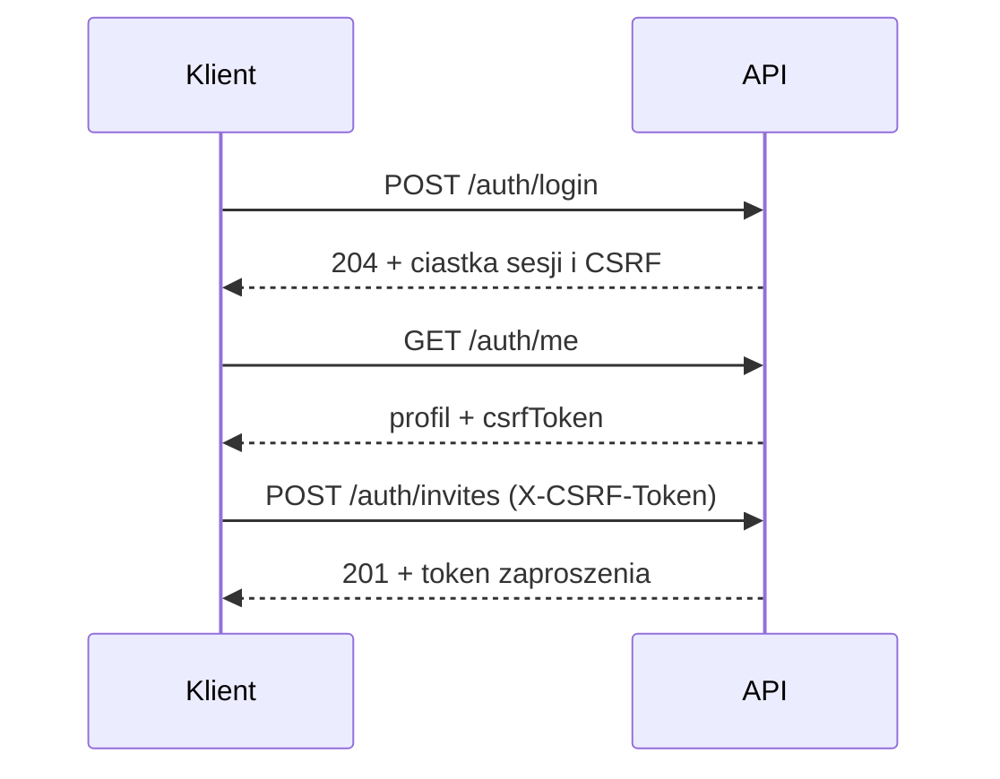

# API

Kontrakt jest w [`api/openapi.yaml`](../api/openapi.yaml) i jest sprawdzany testem `TestRoutesMatchOpenAPI`: każda zarejestrowana trasa musi być opisana i odwrotnie.

Zasady ogólne:
- JSON pod `/api/v1`, błędy w formacie `{"code","message","details"}`.
- Sesja w ciastku `mealplan_session`. Żądania modyfikujące wymagają nagłówka `X-CSRF-Token` (wartość z `GET /auth/me` lub ciastka `mealplan_csrf`).
- Zaproszenia: `GET /auth/invitations/{token}` (podgląd) i `POST /auth/invitations/{token}/accept` (przyjęcie) nie wymagają sesji; wystawianie i unieważnianie (`/auth/invites`) wymaga sesji.

## Zasoby Etapu 2

Wszystkie trasy wymagają sesji, a metody modyfikujące także `X-CSRF-Token`. Wszyscy członkowie gospodarstwa edytują przepisy, plan i listę zakupów; role, członków i zaproszenia zmienia tylko administrator.

| Trasa | Opis |
|---|---|
| `GET /household/members` | członkowie gospodarstwa (np. do wyboru kucharza) |
| `PATCH /household/members/{id}` | zmiana roli (admin); `409 last_admin` przy degradacji ostatniego administratora |
| `DELETE /household/members/{id}` | usunięcie członka (admin); kasuje jego sesje w gospodarstwie i czyści go jako kucharza we wpisach planu; `409 last_admin` dla ostatniego administratora |
| `GET /recipes`, `POST /recipes` | lista (bez składników i kroków) i tworzenie przepisu |
| `GET/PUT/DELETE /recipes/{id}` | odczyt, pełna zamiana i usunięcie; `409 in_use`, gdy przepis jest w planie |
| `GET /plan/{week}` | wpisy planu tygodnia |
| `POST /plan/{week}/entries` | dodanie wpisu: przepis albo tekst wolny, slot, porcje, opcjonalnie kucharz |
| `PUT/DELETE /plan/{week}/entries/{id}` | zamiana i usunięcie wpisu |
| `POST /plan/{week}/copy` | kopiowanie wpisów z `fromWeek`; tylko na pusty tydzień, inaczej `409 conflict`; ten sam tydzień jako źródło i cel daje `422 invalid_input` |
| `GET /shopping?week=` | lista zakupów tygodnia |
| `POST /shopping/generate` | generowanie z planu (`week`, opcjonalnie `from` i `to`) |
| `POST /shopping/items` | dodanie pozycji ręcznej |
| `PATCH /shopping/items/{id}` | samo `checked` przełącza odhaczenie; `name` + `quantity` + `unit` razem edytują pozycję ręczną |
| `DELETE /shopping/items/{id}` | usunięcie pozycji |

`{week}` to poniedziałek w formacie `YYYY-MM-DD`; inna data daje `422 invalid_input`.

### Reguły i uwagi

- Pozycje wygenerowane są tylko do odhaczania; edycja wygenerowanej pozycji daje `422 invalid_input`. Pozycje ręczne można edytować i usuwać.
- Regeneracja zachowuje pozycje ręczne oraz `id` i `checked` pozycji wygenerowanych o niezmienionej nazwie, jednostce i ilości. Zmiana ilości zeruje odhaczenie.
- Generowanie z zakresem dni (`from`, `to`) zastępuje wygenerowane pozycje całego tygodnia pozycjami z tego zakresu.
- Odejmowanie zapasów jest podpięte, ale nieaktywne do Etapu 3.
- `sourceUrl` przepisu musi być adresem `http` lub `https` (albo pusty).

### Kody błędów

| Kod | HTTP | Kiedy |
|---|---|---|
| `invalid_input` | 422 | błędna walidacja (pola, `sourceUrl`, data tygodnia nie jest poniedziałkiem, edycja pozycji wygenerowanej, kopiowanie tygodnia na ten sam tydzień) |
| `bad_request` | 400 | niepoprawny JSON w treści żądania |
| `not_found` | 404 | zasób nie istnieje lub należy do innego gospodarstwa |
| `conflict` | 409 | kopiowanie tygodnia na niepusty tydzień |
| `in_use` | 409 | usunięcie przepisu użytego w planie |
| `last_admin` | 409 | zmiana roli lub usunięcie ostatniego administratora |
| `forbidden` | 403 | brak uprawnień (np. członek zarządza rolami) |
| `csrf` | 403 | brak lub błędny nagłówek `X-CSRF-Token` w żądaniu modyfikującym |
| `too_large` | 413 | treść żądania większa niż 1 MiB |
| `unsupported_media_type` | 415 | brak nagłówka `Content-Type: application/json` (dotyczy tylko tras publicznych: logowanie, pierwsze uruchomienie, zaproszenia) |
| `internal` | 500 | nieoczekiwany błąd serwera (szczegóły tylko w dzienniku) |

Pozostałe kody (`unauthenticated`, `invalid_credentials`, `rate_limited`, `login_taken`, `invite_invalid`, `setup_done`, `password_length`) dotyczą kont i sesji z Etapu 1.
