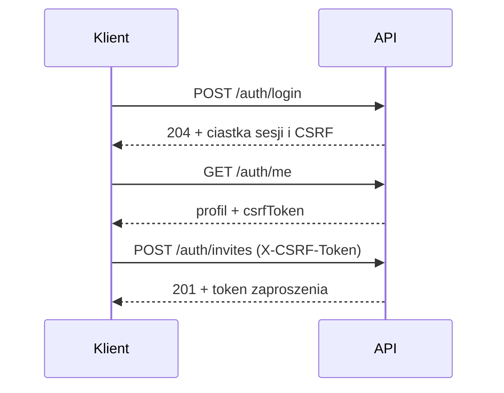

# API

Kontrakt jest w [`api/openapi.yaml`](../api/openapi.yaml) i jest sprawdzany testem `TestRoutesMatchOpenAPI`: każda zarejestrowana trasa musi być opisana i odwrotnie.

Zasady ogólne:
- JSON pod `/api/v1`, błędy w formacie `{"code","message","details"}`.
- Sesja w ciastku `mealplan_session`. Żądania modyfikujące wymagają nagłówka `X-CSRF-Token` (wartość z `GET /auth/me` lub ciastka `mealplan_csrf`).
- Zaproszenia: `GET /auth/invitations/{token}` (podgląd) i `POST /auth/invitations/{token}/accept` (przyjęcie) są publiczne; wystawianie i unieważnianie (`/auth/invites`) wymaga sesji.

