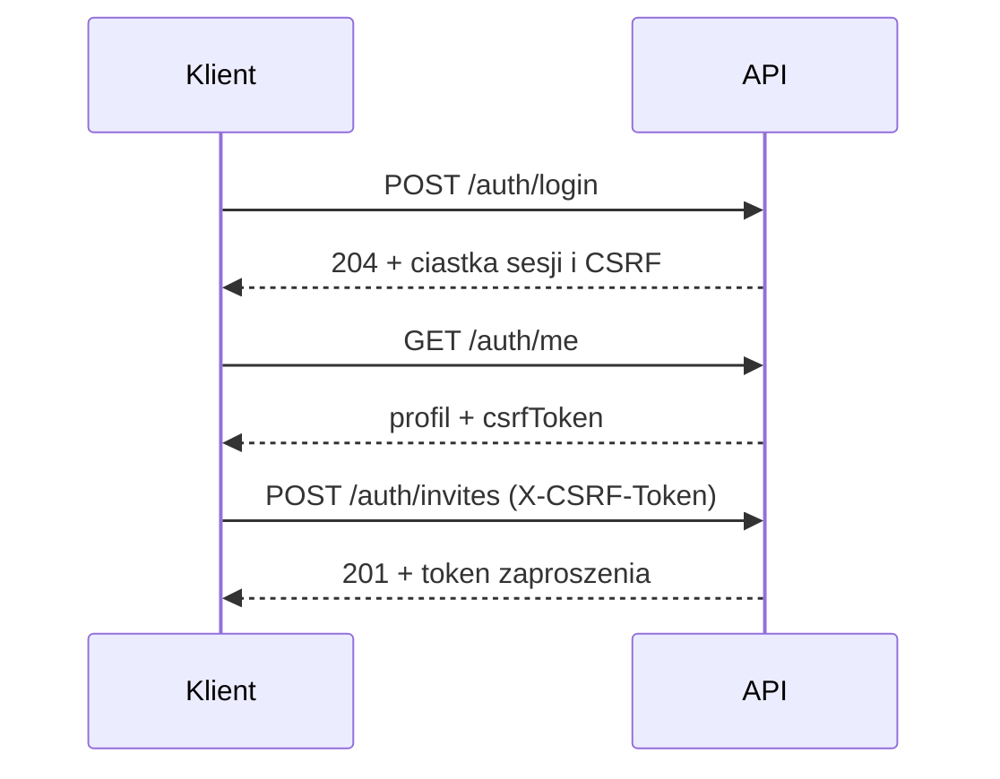

# API

Kontrakt jest w [`api/openapi.yaml`](../api/openapi.yaml) i jest sprawdzany testem `TestRoutesMatchOpenAPI`: każda zarejestrowana trasa musi być opisana i odwrotnie.

Zasady ogólne:
- JSON pod `/api/v1`, błędy w formacie `{"code","message","details"}`.
- Sesja w ciastku `mealplan_session`. Żądania modyfikujące wymagają nagłówka `X-CSRF-Token` (wartość z `GET /auth/me` lub ciastka `mealplan_csrf`).
- Zaproszenia: `GET /auth/invitations/{token}` (podgląd) i `POST /auth/invitations/{token}/accept` (przyjęcie) nie wymagają sesji; wystawianie i unieważnianie (`/auth/invites`) wymaga sesji.

## Zasoby Etapu 2

Wszystkie trasy wymagają sesji, a metody modyfikujące także `X-CSRF-Token`. Wszyscy członkowie gospodarstwa edytują przepisy, plan i listę zakupów; role, członków i zaproszenia zmienia tylko administrator.

| Trasa | Opis |
|---|---|
| `GET /household/members` | członkowie gospodarstwa (np. do wyboru kucharza) |
| `PATCH /household/members/{id}` | zmiana roli (admin); `409 last_admin` przy degradacji ostatniego administratora |
| `DELETE /household/members/{id}` | usunięcie członka (admin); kasuje jego sesje w gospodarstwie i czyści go jako kucharza we wpisach planu; `409 last_admin` dla ostatniego administratora |
| `GET /recipes`, `POST /recipes` | lista (bez składników i kroków) i tworzenie przepisu; składnik ma `name`, `quantity`, `unit` i opcjonalną `note` (uwaga do składnika, do 200 znaków) |
| `GET/PUT/DELETE /recipes/{id}` | odczyt, pełna zamiana i usunięcie; `409 in_use`, gdy przepis jest w planie |
| `POST /recipes/import/url` | szkic przepisu ze strony (`{"url"}`); niczego nie zapisuje; `422 import_blocked`, `import_unparsable`, `import_failed`, `504 import_timeout`; limit 10 na minutę na użytkownika (`429 rate_limited` + `Retry-After`) |
| `POST /recipes/import/text` | szkic przepisu z wklejonego tekstu (`{"text"}`, do 100 KB); niczego nie zapisuje; `422 import_unparsable` |
| `GET /products?q=`, `POST /products` | produkty gospodarstwa (wartości na 100 g, opcjonalnie gęstość i waga sztuki); `q` filtruje po nazwie i aliasach |
| `PUT/DELETE /products/{id}` | zmiana i usunięcie produktu |
| `GET/PUT /me/nutrition` | ustawienia konta: włączone śledzenie i dzienny cel (każda wartość opcjonalna) |
| `GET /me/nutrition/days?from=&to=` | podsumowanie dni z zakresu (najwyżej 31 dni) względem celu; pusta lista `days`, gdy śledzenie jest wyłączone |
| `POST /me/food-log`, `DELETE /me/food-log/{id}` | dziennik jedzenia konta: produkt i ilość w `g` lub `szt` (`szt` tylko dla produktu z wagą sztuki) |
| `GET /plan/{week}` | wpisy planu tygodnia |
| `POST /plan/{week}/entries` | dodanie wpisu: przepis albo tekst wolny, slot, porcje, opcjonalnie kucharz; `kind` (`meal`, domyślnie; `prep`; `out`), `prepDishId` albo `freezerItemId` (dokładnie jedno, dla `prep`) i `outValues` (`kcal`, `protein`, `carbs`, `fat` na osobę, każda opcjonalna, dla `out`); opis: [mealprep.md](mealprep.md) |
| `PUT/DELETE /plan/{week}/entries/{id}` | zamiana i usunięcie wpisu |
| `POST /plan/{week}/copy` | kopiowanie wpisów z `fromWeek`; tylko na pusty tydzień, inaczej `409 conflict`; ten sam tydzień jako źródło i cel daje `422 invalid_input` |
| `GET /shopping?week=` | lista zakupów tygodnia: `{week, items, previousWeekUndone}`; `previousWeekUndone` to liczba posiłków z przepisem z poprzedniego tygodnia, które nie są oznaczone jako zrobione |
| `POST /shopping/generate` | generowanie z planu (`week`, opcjonalnie `from` i `to`); odpowiedź jak przy `GET /shopping` |
| `POST /shopping/items` | dodanie pozycji ręcznej |
| `PATCH /shopping/items/{id}` | samo `checked` przełącza odhaczenie; `name` + `quantity` + `unit` razem edytują pozycję ręczną |
| `DELETE /shopping/items/{id}` | usunięcie pozycji |
| `POST /shopping/move-to-pantry` | `{"week"}`: dodaje odhaczone, jeszcze nieprzeniesione pozycje z ilością do spiżarni; zwraca `{"moved": n}`, ponowne wywołanie daje `moved` 0 |
| `GET /pantry`, `POST /pantry` | pozycje spiżarni i `reviewedAt` (`null`, gdy nie było przeglądu); dodanie: `productId` albo `name` (nazwa pasująca do produktu lub aliasu używa go, nieznana tworzy produkt), `quantity`, `unit`, `expiresOn` (`RRRR-MM-DD`), `staple`; dla pary produkt + jednostka dodanie do istniejącej zwiększa ilość |
| `PUT/DELETE /pantry/{id}` | pełna zamiana ilości, jednostki, daty ważności i `staple` (produkt się nie zmienia); `409 conflict`, gdy produkt ma już pozycję w tej jednostce |
| `POST /pantry/review` | zapisuje datę przeglądu spiżarni; zwraca `{"reviewedAt"}` |
| `GET /prep/sessions`, `POST /prep/sessions` | sesje gotowania z daniami i rozliczeniem porcji (`portions`, `writtenOff`, `allocated`, `frozen`, `remaining`, `allocations`); dodanie: `date`, `name`, opcjonalnie `week` (poniedziałek; domyślnie tydzień wynikający z daty) |
| `PUT/DELETE /prep/sessions/{id}` | zamiana (`date`, `name`, `week`, `cooked`); `cooked: true` zdejmuje składniki ze spiżarni, `false` je zwraca (`500 pantry_failed` przy błędzie spiżarni); usunięcie sesji z przydziałami daje `409 in_use` |
| `POST /prep/sessions/{id}/dishes` | dodanie dania: `recipeId`, `portions` |
| `PUT/DELETE /prep/dishes/{id}` | zmiana `portions` i `writtenOff`; usunięcie dania z przydziałami daje `409 in_use` |
| `POST /prep/dishes/{id}/freeze` | `{"portions"}`: przenosi pozostałe porcje do zamrażalki; zwraca pozycję zamrażalki |
| `GET /freezer`, `POST /freezer` | pozycje zamrażalki (`{"items"}`) i dodanie ręczne: `portions`, opcjonalnie `recipeId`, `label` (domyślnie tytuł przepisu), `frozenOn` (domyślnie dziś) |
| `PUT/DELETE /freezer/{id}` | zamiana i usunięcie pozycji; usunięcie pozycji z przydziałami daje `409 in_use` |
| `GET/PUT /household/settings` | ustawienia gospodarstwa: `{"portionsPerMeal"}` (1-20, domyślnie 2) |

`{week}` to poniedziałek w formacie `YYYY-MM-DD`; inna data daje `422 invalid_input`.

### Reguły i uwagi

- Pozycje wygenerowane są tylko do odhaczania; edycja wygenerowanej pozycji daje `422 invalid_input`. Pozycje ręczne można edytować i usuwać.
- Regeneracja zachowuje pozycje ręczne oraz `id` i `checked` pozycji wygenerowanych o niezmienionej nazwie, jednostce i ilości. Zmiana ilości zeruje odhaczenie.
- Generowanie z zakresem dni (`from`, `to`) zastępuje wygenerowane pozycje całego tygodnia pozycjami z tego zakresu.
- Przepis ma opcjonalne `nutrition` (`kcal`, `protein`, `carbs`, `fat` na porcję) i `ingredients[].productId` (zapamiętany produkt). Tylko w odpowiedziach `GET` są `nutritionPerPortion` (wartości wraz ze źródłem każdej) i `ingredients[].matchedProductId`; szkic importu też ma `nutrition`. Opis: [nutrition.md](nutrition.md).
- Spiżarnia: ilości są zapisywane w jednostkach bazowych (`kg` jako `g`, `l` jako `ml`); `quantity` 0 jest dozwolone, pozycja ze `staple: true` nie ma ilości (`quantity: null`). Pozycja listy zakupów ma `haveQuantity` (zapas odjęty od wiersza, w jednostce pozycji; `null`, gdy brak) i `moved` (już przeniesiona do spiżarni); wiersz w pełni pokryty ma `quantity` 0. Zapis wpisu planu z `done: true` zdejmuje składniki ze spiżarni, a z `done: false` je zwraca; opis: [pantry.md](pantry.md).
- Meal prep: wpis planu ma `kind` (`meal`, `prep`, `out`), `prepDishId`, `freezerItemId` i `outValues` (`null`, gdy nie dotyczy). Wpis `prep` bierze porcje z dania albo pozycji zamrażalki (nie więcej niż zostało; domyślnie `portionsPerMeal`), `out` ma opcjonalny opis w `freeText`, `servings` 1 i wartości na osobę. Zapis wpisu (`PUT`) zastępuje go w całości, więc trzeba odesłać także `kind` i powiązanie. „Zrobione" na wpisie `prep` nie rusza spiżarni, a kopiowanie tygodnia pomija wpisy `prep`. Opis: [mealprep.md](mealprep.md).
- `sourceUrl` przepisu musi być adresem `http` lub `https` (albo pusty).

Szczegóły formatu i ograniczeń importu: [import.md](import.md).

### Kody błędów

| Kod | HTTP | Kiedy |
|---|---|---|
| `invalid_input` | 422 | błędna walidacja (pola, `sourceUrl`, data tygodnia nie jest poniedziałkiem, edycja pozycji wygenerowanej, kopiowanie tygodnia na ten sam tydzień) |
| `bad_request` | 400 | niepoprawny JSON w treści żądania |
| `not_found` | 404 | zasób nie istnieje lub należy do innego gospodarstwa |
| `conflict` | 409 | kopiowanie tygodnia na niepusty tydzień |
| `in_use` | 409 | usunięcie przepisu użytego w planie albo sesji, dania lub pozycji zamrażalki z przydziałami |
| `last_admin` | 409 | zmiana roli lub usunięcie ostatniego administratora |
| `forbidden` | 403 | brak uprawnień (np. członek zarządza rolami) |
| `csrf` | 403 | brak lub błędny nagłówek `X-CSRF-Token` w żądaniu modyfikującym |
| `too_large` | 413 | treść żądania większa niż 1 MiB |
| `unsupported_media_type` | 415 | brak nagłówka `Content-Type: application/json` (dotyczy tylko tras publicznych: logowanie, pierwsze uruchomienie, zaproszenia) |
| `import_blocked` | 422 | adres importu wskazuje na zablokowany zakres (SSRF), także po przekierowaniu |
| `import_unparsable` | 422 | w źródle importu nie znaleziono przepisu |
| `import_failed` | 422 | nie udało się pobrać strony (status inny niż 2xx, zły typ treści, za duży plik, zbyt wiele przekierowań, błąd sieci) |
| `import_timeout` | 504 | strona nie odpowiedziała w 10 s |
| `pantry_failed` | 500 | wpis planu zapisano, ale aktualizacja spiżarni (zdjęcie lub zwrot składników) się nie udała; ponowny zapis wpisu naprawia stan |
| `internal` | 500 | nieoczekiwany błąd serwera (szczegóły tylko w dzienniku) |

Pozostałe kody (`unauthenticated`, `invalid_credentials`, `rate_limited` (też przy imporcie z linku, z nagłówkiem `Retry-After`), `login_taken`, `invite_invalid`, `setup_done`, `password_length`) dotyczą kont i sesji z Etapu 1.
