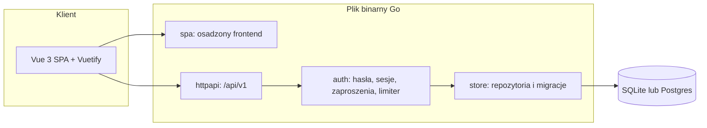
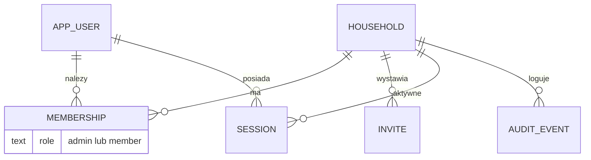
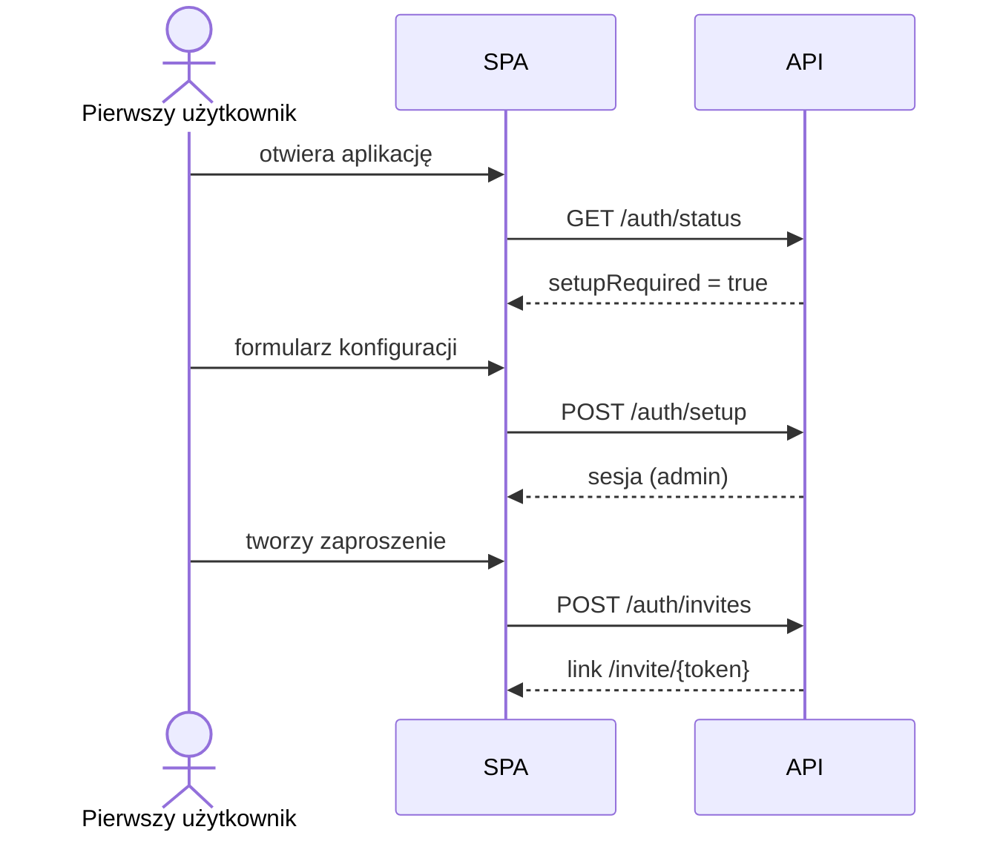
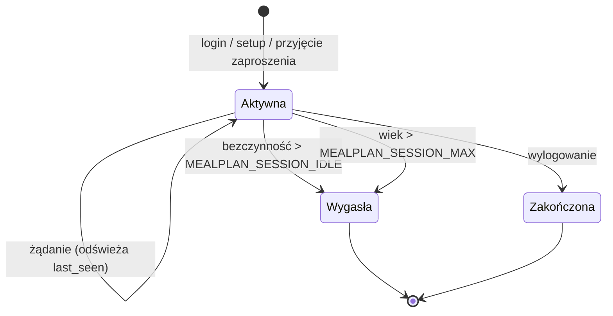

# Architektura

Mealplan to jeden plik binarny Go z osadzonym frontendem Vue. Dane trzyma w SQLite (tryb `selfhost`) lub Postgres (tryb `hosted`, Etap 5).

## Komponenty (stan po Etapie 1)

## Model danych

Tabela użytkowników nazywa się `app_user`, bo `user` jest słowem zastrzeżonym w Postgres. Czasy są zapisane jako unix seconds (`BIGINT`). Każda przyszła tabela domenowa dostanie `household_id`.

## Pierwsze uruchomienie i zaproszenia

## Cykl życia sesji

## Przepływ żądania

Żądanie przechodzi przez nagłówki bezpieczeństwa, router, a dla tras prywatnych przez uwierzytelnienie sesji i (dla metod modyfikujących) sprawdzenie CSRF. Pakiety domenowe nie znają HTTP, a `httpapi` nie zna SQL.
