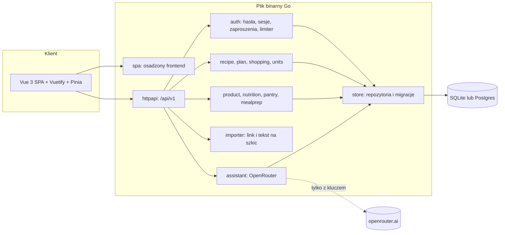
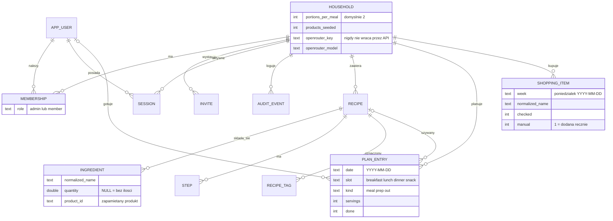
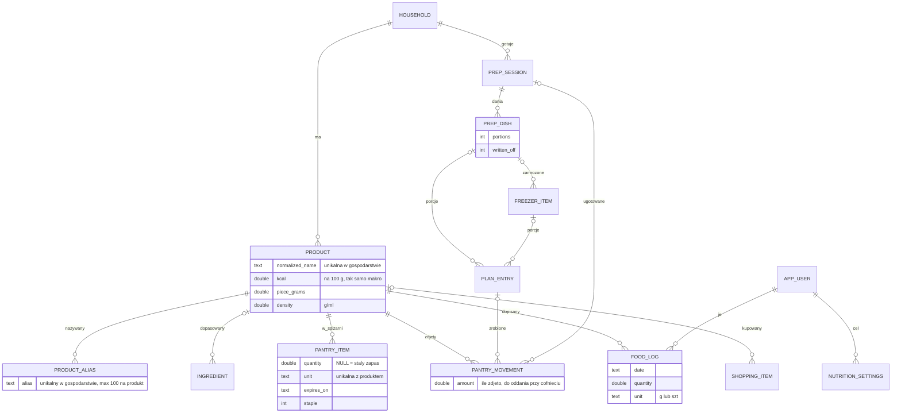
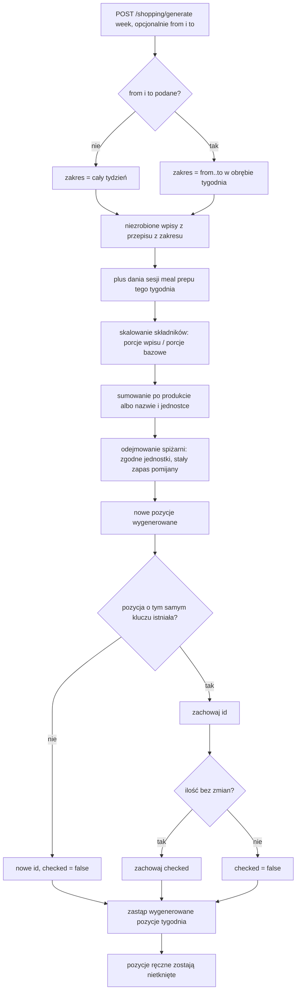
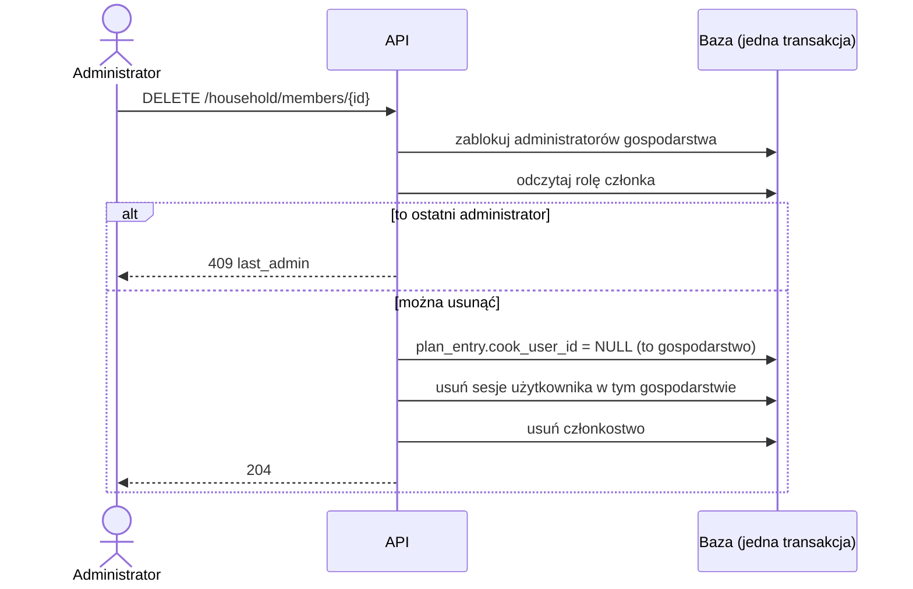
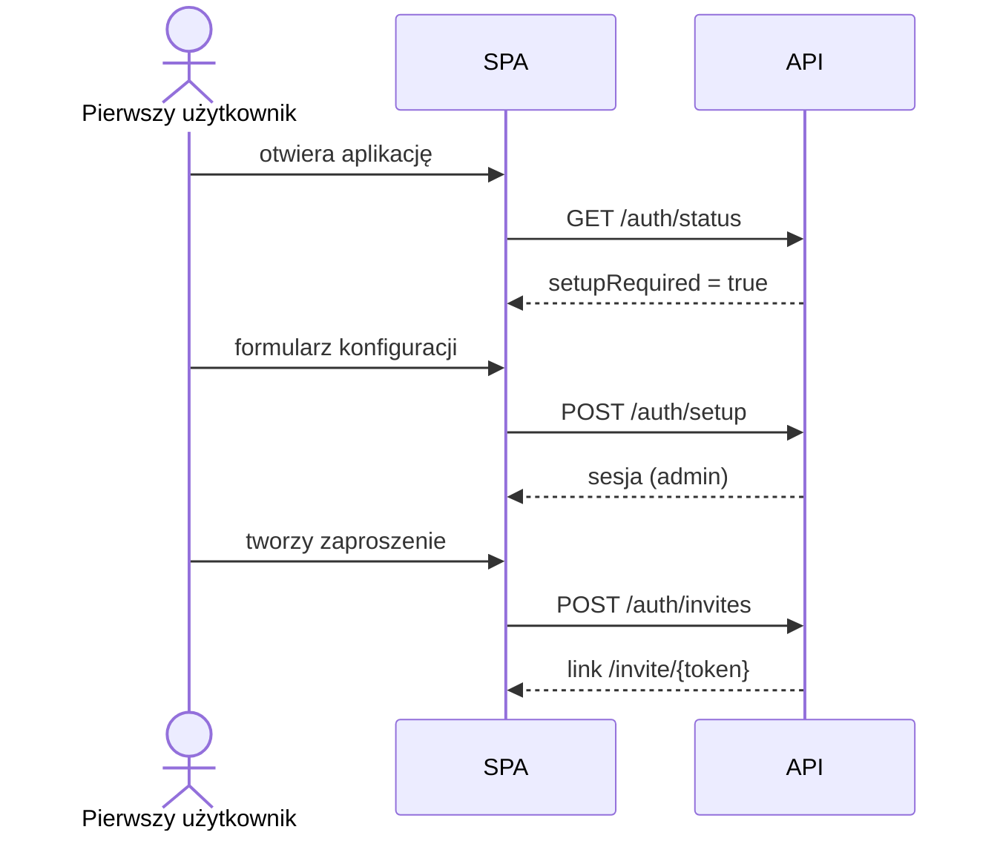
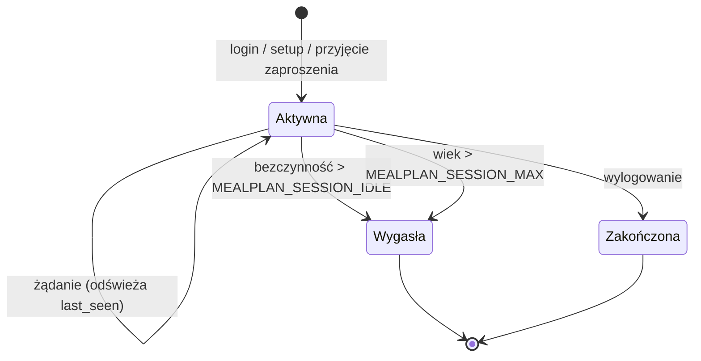

# Architektura

Mealplan to jeden plik binarny Go z osadzonym frontendem Vue. Dane trzyma w SQLite (tryb `selfhost`) albo w Postgresie. Migracje są przenośne na oba silniki, a testy warstwy `store` przechodzą na obu.

## Komponenty

- `importer` niczego nie zapisuje: zwraca szkic, który użytkownik poprawia i zapisuje w edytorze ([Import](import.md)).
- `product` to baza produktów gospodarstwa z aliasami. Z niej korzystają `nutrition` (kalorie), `pantry` (spiżarnia) i `shopping` (odejmowanie zapasów). Startowe produkty pochodzą z `internal/nutrition/seed/products.csv` i trafiają do gospodarstwa przy pierwszym użyciu.
- `assistant` łączy się wyłącznie z `https://openrouter.ai/api/v1/chat/completions` i tylko wtedy, gdy administrator ustawił klucz. Zwraca propozycje; zapis robi zawsze osobne żądanie po zatwierdzeniu ([Bezpieczeństwo](security.md)).

## Model danych

Tabele kont i przepisów:

Tabele produktów, spiżarni i meal prepu:

Tabela użytkowników nazywa się `app_user`, bo `user` jest słowem zastrzeżonym w Postgresie. Czasy są zapisane jako unix seconds (`BIGINT`). Każda tabela domenowa ma `household_id` (`ingredient`, `step` i `recipe_tag` dziedziczą go przez `recipe`).

Rozstrzygnięcia:
- Tagi są w osobnej tabeli `recipe_tag`, żeby statystyki po tagach były zwykłym `GROUP BY`.
- `shopping_item.normalized_name` służy do dopasowania pozycji przy regeneracji listy.
- Tydzień jest identyfikowany poniedziałkiem w formacie `YYYY-MM-DD` (inna data w ścieżce daje `422 invalid_input`).
- `plan_entry.recipe_id` ma `ON DELETE RESTRICT`: przepisu użytego w planie nie da się usunąć (`409 in_use`). `cook_user_id` ma `ON DELETE SET NULL`.
- Wpis planu ma rodzaj (`kind`): `meal` (dokładnie jedno z: przepis albo tekst wolny), `prep` (porcje z dania sesji albo z zamrażalki) albo `out` (posiłek na mieście z opcjonalnymi wartościami). Pilnuje tego `CHECK`.
- `food_log.product_id` ma `ON DELETE RESTRICT`: produktu z dziennika domowników nie da się usunąć. Scalanie produktów przepina wszystkie odniesienia w jednej transakcji ([Wartości odżywcze](nutrition.md)).
- `pantry_movement` zapamiętuje, co zdjęło „Zrobione” albo „Ugotowane”, więc cofnięcie oddaje dokładnie to samo.

## Generowanie listy zakupów

Zasady: pozycje wygenerowane są tylko do odhaczania, edytować i usuwać można ręczne. Regeneracja zawsze zastępuje wszystkie wygenerowane pozycje całego tygodnia, więc generowanie z zakresem dni (`from`, `to`) zostawia po sobie wyłącznie pozycje z tego zakresu. To, co jest w spiżarni, trafia do sekcji „Masz w domu” zamiast do zakupów; szczegóły w [Spiżarnia](pantry.md). Porcje z meal prepu nie trafiają na listę drugi raz: składniki liczy sesja gotowania ([Meal prep](mealprep.md)).

## Wersje językowe

Interfejs jest po polsku (domyślnie) albo po angielsku. Język wybiera się na stronie logowania i na stronie Konto; zapamiętuje go przeglądarka (`localStorage`, klucz `mealplan.locale`), a zmiana przeładowuje stronę.

- Wszystkie teksty są w `web/src/locales/pl.ts` i `web/src/locales/en.ts`, a komponenty biorą je z `t` w `web/src/messages.ts`. Angielski słownik ma typ polskiego, więc brakujący klucz zatrzymuje build; test `web/src/i18n.test.ts` pilnuje, żeby w angielskich tekstach nie było polskich liter.
- Daty i liczby idą przez `Intl` z tagiem z `web/src/i18n.ts` (`pl-PL` albo `en-GB`). Odmiana porcji i jednostek kuchennych (`łyżka` → `tbsp`) jest w słownikach.
- API zwraca kody błędów; ich treść tłumaczy frontend. Przepisy, nazwy produktów (także startowe) i dokumentacja zostają po polsku.

Nowy język to nowy plik w `web/src/locales/`, wpis w `LOCALES` w `i18n.ts` i komunikaty Vuetify w `plugins/vuetify.ts`.

## Usunięcie członka gospodarstwa

Konto użytkownika (`app_user`) zostaje; kasowane są tylko członkostwo i sesje w tym gospodarstwie. Ta sama blokada administratorów chroni zmianę roli (`PATCH`): ostatniego administratora nie można zdegradować.

## Pierwsze uruchomienie i zaproszenia

## Cykl życia sesji

## Przepływ żądania

Żądanie przechodzi przez nagłówki bezpieczeństwa, router, a dla tras prywatnych przez uwierzytelnienie sesji i (dla metod modyfikujących) sprawdzenie CSRF. Pakiety domenowe nie znają HTTP, a `httpapi` nie zna SQL.
