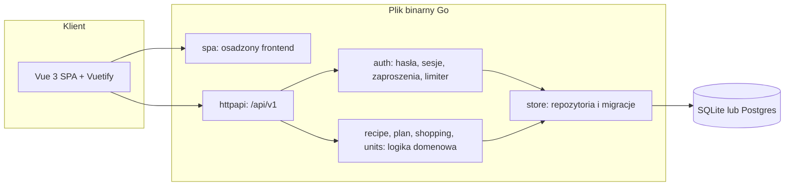
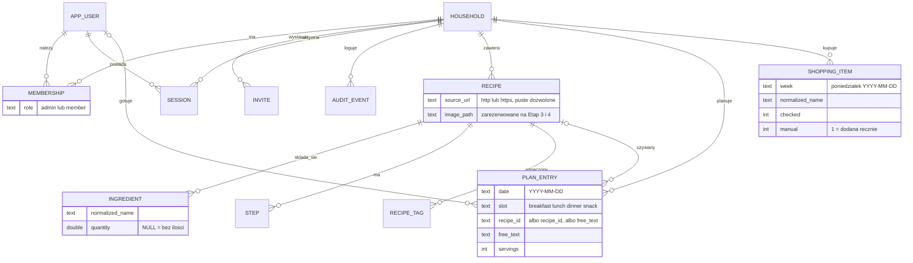
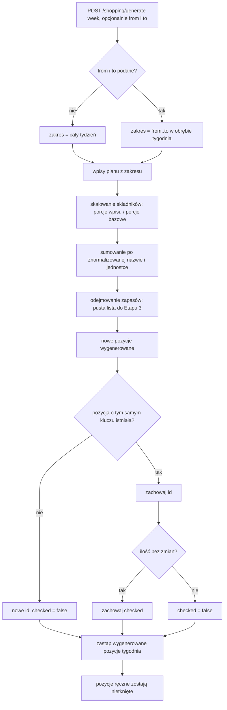
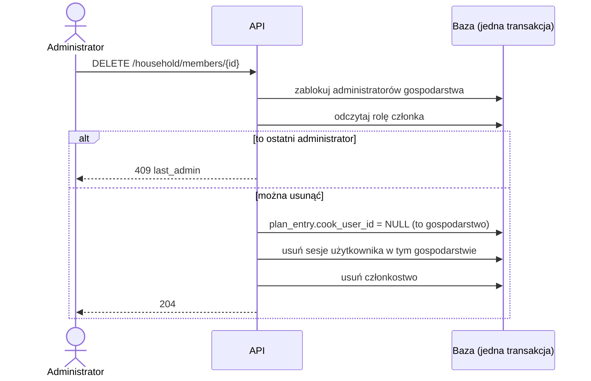
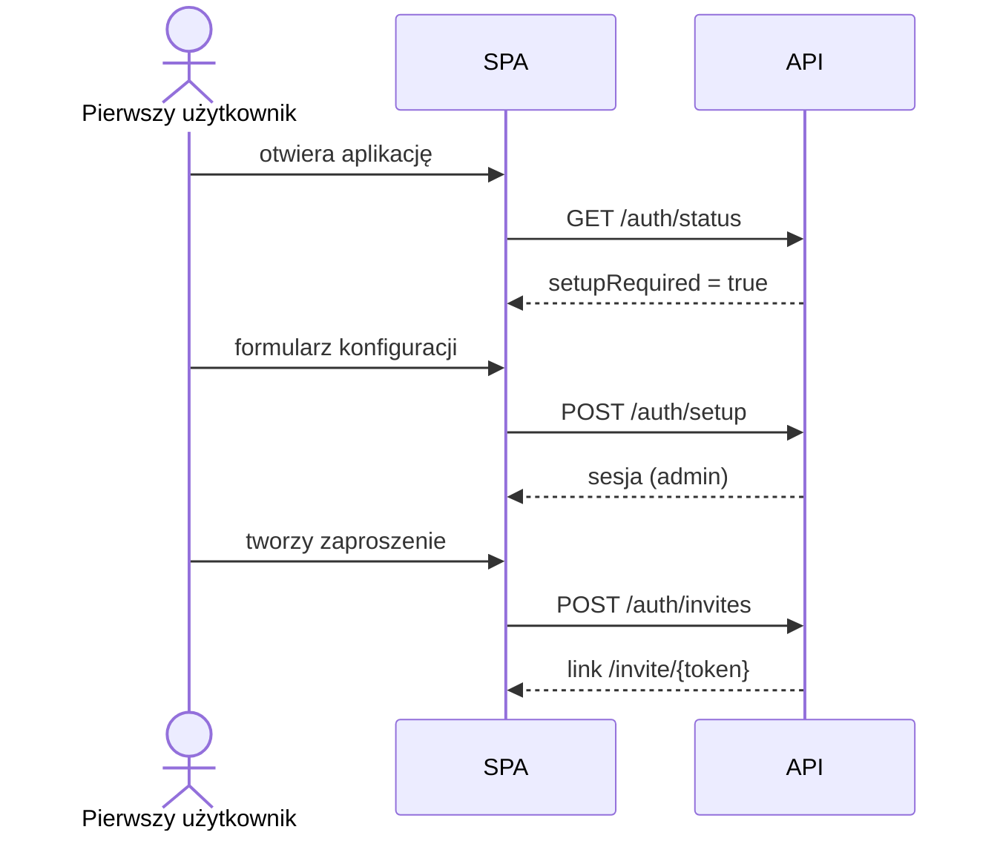
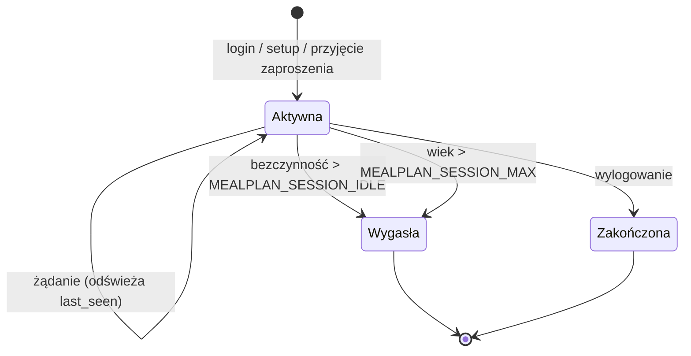

# Architektura

Mealplan to jeden plik binarny Go z osadzonym frontendem Vue. Dane trzyma w SQLite (tryb `selfhost`) lub Postgres (tryb `hosted`, Etap 5).

## Komponenty (stan po Etapie 2)

## Model danych

Tabela użytkowników nazywa się `app_user`, bo `user` jest słowem zastrzeżonym w Postgres. Czasy są zapisane jako unix seconds (`BIGINT`). Każda tabela domenowa ma `household_id` (`ingredient`, `step` i `recipe_tag` dziedziczą go przez `recipe`).

Rozstrzygnięcia Etapu 2:
- Tagi są w osobnej tabeli `recipe_tag`, żeby statystyki po tagach (Etap 4) były zwykłym `GROUP BY`.
- `shopping_item.normalized_name` służy do dopasowania pozycji przy regeneracji listy.
- Tydzień jest identyfikowany poniedziałkiem w formacie `YYYY-MM-DD` (inna data w ścieżce daje `422 invalid_input`).
- `plan_entry.recipe_id` ma `ON DELETE RESTRICT`: przepis użyty w planie nie da się usunąć (`409 in_use`). `cook_user_id` ma `ON DELETE SET NULL`.
- Wpis planu ma dokładnie jedno z: przepis albo tekst wolny (`CHECK`).

## Generowanie listy zakupów

Zasady: pozycje wygenerowane są tylko do odhaczania, edytować i usuwać można ręczne. Regeneracja zawsze zastępuje wszystkie wygenerowane pozycje całego tygodnia, więc generowanie z zakresem dni (`from`, `to`) zostawia po sobie wyłącznie pozycje z tego zakresu. Odejmowanie zapasów jest podpięte w `shopping.Build`, ale w Etapie 2 dostaje pustą listę (aktywne od Etapu 3).

## Usunięcie członka gospodarstwa

Konto użytkownika (`app_user`) zostaje; kasowane są tylko członkostwo i sesje w tym gospodarstwie. Ta sama blokada administratorów chroni zmianę roli (`PATCH`): ostatniego administratora nie można zdegradować.

## Pierwsze uruchomienie i zaproszenia

## Cykl życia sesji

## Przepływ żądania

Żądanie przechodzi przez nagłówki bezpieczeństwa, router, a dla tras prywatnych przez uwierzytelnienie sesji i (dla metod modyfikujących) sprawdzenie CSRF. Pakiety domenowe nie znają HTTP, a `httpapi` nie zna SQL.
