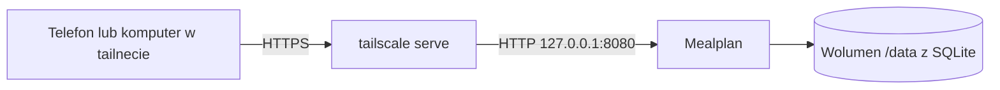

# Wdrożenie selfhost z Tailscale



## Docker

```bash
docker build -t mealplan .
docker run -d --name mealplan --restart unless-stopped \
  -p 127.0.0.1:8080:8080 -v mealplan-data:/data mealplan
```

Obraz działa jako użytkownik `nonroot` (uid 65532), a katalog `/data` jest w nim utworzony z tym właścicielem. Wolumen nazwany (`mealplan-data`) działa od razu. Jeśli zamiast wolumenu zamontujesz katalog z hosta (`-v ./data:/data`), musi on być zapisywalny dla uid 65532:

```bash
mkdir -p data && sudo chown 65532:65532 data
```

## HTTPS przez Tailscale

```bash
tailscale serve --bg 8080
```

Aplikacja będzie dostępna pod adresem maszyny w tailnecie z certyfikatem HTTPS. Zostaw `MEALPLAN_COOKIE_SECURE=true`.

## Pierwsze uruchomienie

Otwórz adres aplikacji. Pierwsza osoba tworzy gospodarstwo i konto administratora, a kolejne dołączają przez linki zaproszeń (Domownicy, Zaproszenia).

## Kopia zapasowa

Zatrzymaj kontener i skopiuj plik `mealplan.db` (oraz `-wal` i `-shm`, jeśli istnieją) z wolumenu `/data`.
