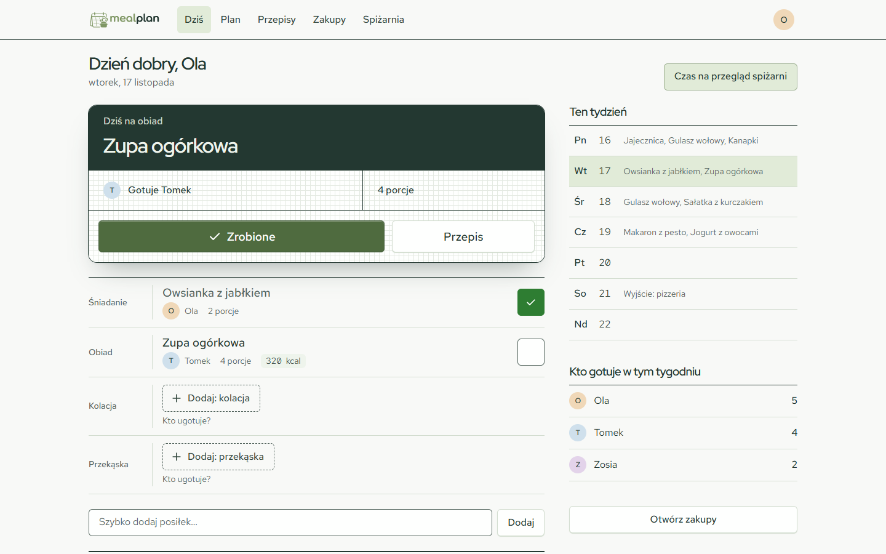
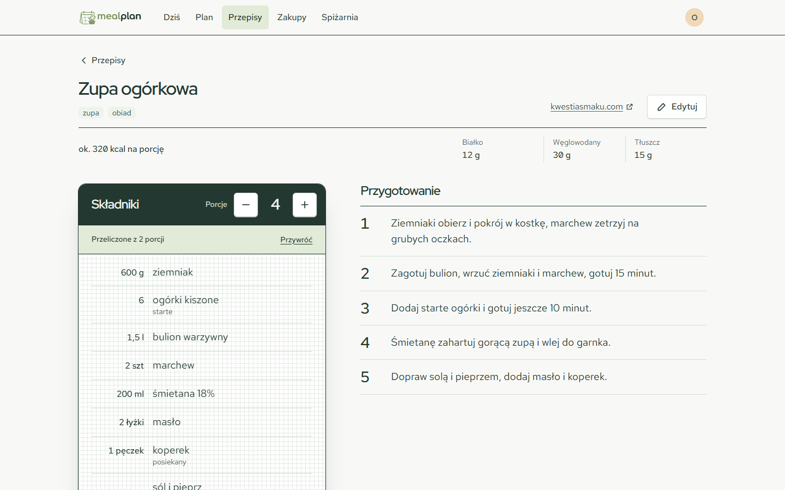
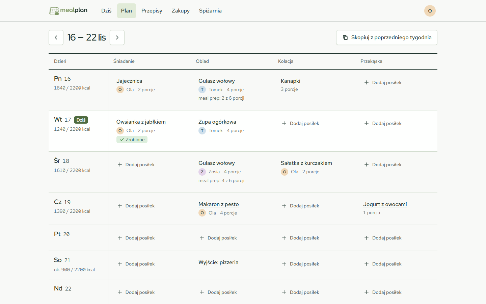

# Nowy wygląd: „spokojnie jak notes” w kolorach Mealplana

Wybrany kierunek wyglądu (listopad 2026), wzorzec dla punktu 6 roadmapy („Nowy wygląd”). To statyczne makiety HTML/CSS trzech głównych ekranów, a nie kod aplikacji: wdrożenie w Vue i Vuetify to osobny etap.

Mealplan prowadzony jak kuchenny notes. Na ekranie Dziś jest jedna karta z tym, co gotujemy teraz, kto gotuje i ile porcji, a pod nią duży przycisk „Zrobione”; wszystko inne to spokojne, liniowane strony. Plan tygodnia to jedna linijka na dzień (na telefonie blok na dzień), a przepis czyta się z daleka: składniki w karcie z licznikiem porcji, kroki dużą czcionką.

## Zrzuty

| Ekran | Komputer (1440 × 900) | Telefon (375) |
|---|---|---|
| Dziś | [dzis-desktop.png](screenshots/dzis-desktop.png) | [dzis-phone.png](screenshots/dzis-phone.png) |
| Przepis (4 porcje z przepisu na 2) | [przepis-desktop.png](screenshots/przepis-desktop.png) | [przepis-phone.png](screenshots/przepis-phone.png) |
| Plan | [plan-desktop.png](screenshots/plan-desktop.png) | [plan-phone.png](screenshots/plan-phone.png) |

## Makiety

Otwórz w przeglądarce [dzis.html](dzis.html), [przepis.html](przepis.html) albo [plan.html](plan.html) z lokalnej kopii repozytorium. W przepisie przyciski − i + naprawdę przeliczają ilości według zasad z `docs/superpowers/specs/2026-11-17-recipe-view-design.md`. Dane są przykładowe (Ola, Tomek, Zosia, tydzień 16–22 listopada).

## System

- **Kolory** (`tokens.css` i początek `app.css`): tło `#F8F9F7`, powierzchnie `#FEFFFE` i `#EEF4EC`, tekst i nagłówek karty `#233831`, tekst drugorzędny `#55665F`, linie `#D3DDD0`, główna akcja i zaznaczenia `#4F6B3F` z białym tekstem, „zrobione” `#2E7D32`, ozdobniki szałwiowe `#7B9A68` i `#9EBA8D`, błąd `#B3261E`. Logo: znak `#7F9764`, napis `#20352E`. Wszystkie pary tekst/tło spełniają WCAG AA.
- **Czcionki:** Red Hat Display (nagłówki), Red Hat Text (treść, cyfry o stałej szerokości w ilościach), Red Hat Mono (pojedyncze liczby w kolumnach).
- **Kształty:** przyciski-klawisze z zaokrągleniem 6 px, karty 10 px, cienkie linie zamiast ramek, kratka w tle karty „Dziś na obiad”.
- **Nawigacja:** górny pasek z logo i linkami; poniżej 60rem pasek zakładek na dole ekranu. Przy wdrożeniu dochodzi „Meal prep”, którego makiety nie mają.
- **Stany:** narysowane są stany pełne i puste (wolna pora posiłku, wolny dzień). Stany ładowania i błędu powstaną przy wdrożeniu.

Makiety powstały z pomocą Hallmark (motyw Furrow w palecie Mealplana). Pierwsza linia `app.css` to jego metryczka; `tokens.css` i `base.css` to wygenerowana baza.
