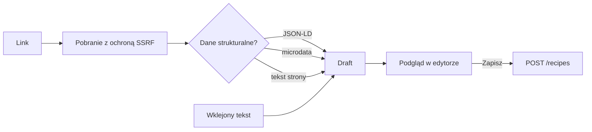

# Import przepisów

Import zamienia link do strony z przepisem albo wklejony tekst w **szkic** (`Draft`), który użytkownik sprawdza i poprawia w edytorze. Import niczego nie zapisuje: przepis powstaje dopiero po kliknięciu „Zapisz", istniejącym `POST /recipes` (lub `PUT /recipes/{id}` przy aktualizacji). Parser jest deterministyczny, bez udziału LLM.

Każda linia składnika, niezależnie od źródła, przechodzi przez ten sam parser linii (patrz niżej).

## Link

`POST /recipes/import/url` z `{"url": "…"}`. Źródła sprawdzane po kolei, pierwsze użyteczne wygrywa:

1. **JSON-LD** `Recipe` (także w `@graph` i tablicach): tytuł, porcje, składniki, kroki, tagi (`keywords`, `recipeCategory`).
2. **Microdata** `itemtype=…/Recipe`, jeśli nie ma JSON-LD.
3. **Tekst strony** (bez `script`, `style`, `nav`, `footer` itp.) przepuszczony przez parser tekstu. Wynik dostaje ostrzeżenie, że opiera się na tekście strony. Tę ścieżkę przyjmujemy tylko, gdy znaleziono co najmniej 2 składniki i co najmniej 1 krok; inaczej `422 import_unparsable`, żeby nawigacja i proza nie zamieniły się w fałszywy przepis.

| Limit lub reguła | Wartość |
|---|---|
| Rozmiar strony | 2 MB (większa: `import_failed`) |
| Czas | 10 s |
| Przekierowania | najwyżej 5; każde jest sprawdzane tak jak pierwszy adres |
| Adres | tylko `http` i `https`, bez danych logowania, porty tylko 80 i 443 (lub brak portu) |
| Typ treści | tylko HTML (`text/html`, `application/xhtml+xml`); odpowiedź inna niż 2xx lub inny typ to `import_failed` |
| Częstotliwość | 10 importów z linku na minutę na użytkownika (`429 rate_limited` + `Retry-After`) |
| Proxy | proxy z zmiennych środowiskowych jest ignorowane |

Kodowanie: UTF-8 oraz starsze strony (np. ISO-8859-2, windows-1250), rozpoznawane po nagłówku `Content-Type` lub `<meta charset>`; treść jest zamieniana na UTF-8. Ochrona przed SSRF jest opisana w [security.md](security.md).

Błędy:

| Kod | HTTP | Kiedy |
|---|---|---|
| `invalid_input` | 422 | zły adres (nie `http`/`https`, dane logowania, zły port, pusty lub dłuższy niż 2000 znaków) |
| `import_blocked` | 422 | adres (lub przekierowanie) wskazuje na zablokowany zakres |
| `import_failed` | 422 | nie udało się pobrać strony: status inny niż 2xx, zły typ treści, za duży plik, zbyt wiele przekierowań, przekierowanie na nieobsługiwany adres, inny błąd sieci |
| `import_timeout` | 504 | strona nie odpowiedziała w 10 s |
| `import_unparsable` | 422 | na stronie nie znaleziono przepisu; komunikat podpowiada wklejenie tekstu |
| `rate_limited` | 429 | więcej niż 10 importów z linku w minutę |

## Tekst

`POST /recipes/import/text` z `{"text": "…"}`. Limit to 100 KB; pusty tekst to `invalid_input`, a tekst bez żadnego składnika ani kroku to `import_unparsable`.

- **Nagłówki sekcji** (PL i EN, wielkość liter bez znaczenia, z dwukropkiem lub bez, z `#`, `*`): `Składniki`, `Ingredients` oraz `Przygotowanie`, `Sposób przygotowania`, `Sposób wykonania`, `Wykonanie`, `Kroki`, `Instrukcje`, `Method`, `Instructions`, `Directions`, `Preparation`, `Jak zrobić`. Etykiety grup wewnątrz składników (`Na ciasto:`) są pomijane.
- **Tytuł**: nagłówek `# …` ma pierwszeństwo; inaczej pierwsza linia, jeśli nie jest nagłówkiem sekcji, składnikiem, wypunktowaniem ani numerowanym krokiem (do 15 słów).
- **Porcje**: `Porcje: 4`, `4 porcje`, `dla 4 osób`, `serves 4`, `servings 4`, `yield 4`. Brak liczby daje `0` i ostrzeżenie, a edytor podstawia 4.
- **Numeracja i wypunktowania** (`1.`, `1)`, `Krok 1:`, `-`, `*`, `•`) są usuwane z tekstu kroku.
- **Kroki**: jeśli w sekcji kroków jest choć jedna numerowana lub wypunktowana linia, nieoznaczone linie są traktowane jako ciąg dalszy poprzedniego kroku (łączenie zawiniętych linii). Bez żadnej numeracji każda linia jest osobnym krokiem.
- **Bez nagłówków** linia jest klasyfikowana: numerowana to krok, wypunktowana krótka (do 8 słów) lub zaczynająca się od ilości to składnik, dłuższa (od 4 słów) to krok. Krótkie linie, których nie da się sklasyfikować, są pomijane z ostrzeżeniem; przy nagłówkach ostrzeżenie dotyczy linii spoza sekcji.

Szkic jest przycinany do limitów przepisu (tytuł 200 znaków, 200 składników, 100 kroków po 2000 znaków, 20 tagów); to, co obcięto, trafia do ostrzeżeń.

## Linia składnika

Parser dzieli linię na ilość, jednostkę, nazwę i notatkę. Nigdy nie gubi linii: czego nie rozumie, zwraca jako `unparsed` z nienaruszonym tekstem w polu `raw`.

| Wejście | Ilość | Jednostka | Nazwa | Notatka | Pewność |
|---|---|---|---|---|---|
| `250 g mąki` | 250 | g | mąki | | `ok` |
| `250g mąki` | 250 | g | mąki | | `ok` |
| `1/2 szklanki mleka` | 0,5 | szklanka | mleka | | `ok` |
| `1 1/2 łyżki oleju` | 1,5 | łyżka | oleju | | `ok` |
| `2,5 l wody` | 2,5 | l | wody | | `ok` |
| `10 dag sera` | 100 | g | sera | | `ok` |
| `2-3 ząbki czosnku` | 3 | ząbek | czosnku | | `guess` |
| `2 jajka` | 2 | szt | jajka | | `guess` |
| `sól do smaku` | | | sól | do smaku | `ok` |
| `pietruszka (świeża), posiekana` | | | pietruszka | świeża, posiekana | `ok` |
| `szczypta soli` | | szczypta | soli | | `ok` |
| `mąka - 250 g` | 250 | g | mąka | | `guess` |
| `coś zupełnie niejasnego, co nie jest składnikiem w żadnym sensie, naprawdę` | | | | | `unparsed` |

Zasady:

- `ok`: linia rozpoznana jednoznacznie. `guess`: parser coś założył i użytkownik powinien to sprawdzić. `unparsed`: nie udało się wyodrębnić nazwy lub ilości; wiersz jest wyraźnie podświetlony.
- `dag` i `dkg` są przeliczane na gramy (`10 dag` to 100 g).
- Zakres (`2-3`, `2 do 3`) daje wartość górną i oznaczenie `guess`.
- Ilość bez jednostki (`2 jajka`) dostaje jednostkę `szt` i `guess`.
- Brak ilości daje pustą ilość (`sól do smaku`); jednostki metryczne (`g`, `kg`, `ml`, `l`, `szt`) bez liczby nie są uznawane za jednostkę.
- Zwroty typu `do smaku`, `do posypania`, `opcjonalnie` oraz tekst w nawiasach i po przecinku trafiają do **notatki**. Notatka jest tylko podglądem w edytorze: **nie jest zapisywana** w przepisie.
- Linie dłuższe niż 10 słów są `unparsed`.
- W edytorze linia `unparsed` ma jako nazwę swój oryginalny tekst (do 200 znaków), więc nic nie ginie; podświetlenie prosi o poprawę.

## Limity pracy parsera

Parser ma twarde granice, żeby ogromna strona lub wklejka nie zużyła czasu ani pamięci:

- tekst jest przetwarzany najwyżej do 5000 niepustych linii (dalsze są odcinane z ostrzeżeniem „przetworzono tylko pierwsze 5000 linii");
- zbieranie składników kończy się po 210 liniach, a kroków po 110 (limity przepisu 200 i 100 plus mały zapas); nadmiar jest pomijany z ostrzeżeniem, dotyczy to też list z JSON-LD i microdata;
- krok łączony z zawiniętych linii przestaje rosnąć po ok. 8000 znakach (i tak zostanie skrócony do 2000);
- znaki sterujące (C0 poza tabulatorem, znakiem nowej linii i CR, które zostają, oraz DEL) są zamieniane w spacje, bo walidacja przepisu by je odrzuciła;
- `recipeYield` wyrażony objętością lub wagą (`około 1650 ml`) nie jest traktowany jako liczba porcji; liczy się pierwsza liczba (`4 porcje (ok. 2 l)` to 4).
- Tekst strony: każdy nagłówek otwiera blok. Menu nawigacyjne z linkiem „Składniki" przed właściwą sekcją jest pomijane (blok bez ilości i jednostek, gdy inny je ma). Pominięty blok jest zgłaszany ostrzeżeniem z liczbą linii. Lista ponad 60 składników, w której prawie żaden nie ma ilości ani jednostki, jest uznawana za menu, a źródło za nieużyteczne.
- Ostrzeżenia o przycięciu list pojawiają się raz.

Parser linii składnika rozpoznaje też ilość po nazwie („czosnek 2 ząbki", „sól 1 płaska łyżeczka"; jednostka jest wtedy wymagana) oraz przymiotnik między liczbą a jednostką („1 płaska łyżeczka", „2 czubate łyżki").

## Duplikaty i aktualizacja

Po analizie edytor porównuje szkic z listą przepisów. Za duplikat uważany jest przepis o tym samym znormalizowanym adresie źródła (bez schematu, `www.`, fragmentu `#…` i końcowych `/`, wielkość liter bez znaczenia) albo o takim samym tytule (wielkość liter bez znaczenia). Użytkownik wybiera:

- **Zaktualizuj istniejący**: zapis zastąpi tytuł, składniki i kroki istniejącego przepisu. Gdy szkic czegoś nie ma, zachowane zostaje to, co jest w istniejącym przepisie: tytuł, liczba porcji, adres źródła, tagi, składniki i kroki.
- **Dodaj jako nowy**: powstaje osobny przepis.

## Znane ograniczenia

- Brak lematyzacji nazw („jajka" nie jest sprowadzane do „jajko"); scalanie na liście zakupów korzysta z `units.NormalizeName`.
- Czasy przygotowania są pomijane.
- Strony renderowane po stronie przeglądarki (JavaScript) nie zadziałają, bo pobieramy tylko HTML; wklej wtedy tekst przepisu.
- W edytorze nie ma zmiany kolejności kroków (można je edytować i usuwać).
- Import plików `.md` jest planowany na tym samym potoku (`Draft` z pliku zamiast z linku).
