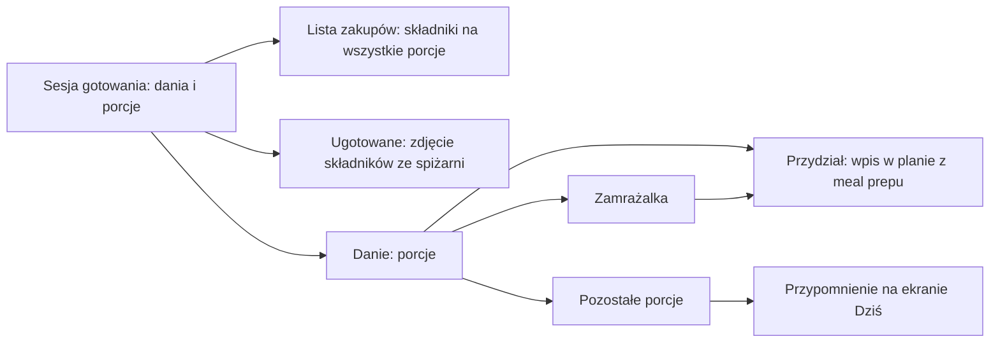

# Meal prep

Meal prep to gotowanie na kilka dni naraz: jedna sesja, kilka dań, a porcje rozdzielasz potem na posiłki w planie albo wkładasz do zamrażalki. Wszystko jest liczone deterministycznie, bez udziału LLM.

## Sesje i dania

Zakładka „Meal prep" ma dwie części: „Sesje" i „Zamrażalka".

- **Sesja** ma datę i nazwę (domyślnie „Gotowanie 2 XI") oraz dania. **Danie** to przepis i liczba porcji, które z niego ugotowano.
- **Porcje skalują składniki**: 12 porcji przepisu na 4 porcje to trzy razy więcej składników. Wielkość i wartości odżywcze jednej porcji się nie zmieniają.
- Karta dania pokazuje, ile porcji jest w planie, w zamrażalce i ile zostało, oraz przydziały („Pn śniadanie ×2"). Porcje zjedzone albo wyrzucone poza planem zapisujesz jako „Zjedzone/wyrzucone".
- **Pozostałe** porcje to te, których nikt jeszcze nie przydzielił, nie zamroził ani nie odpisał.

## Tydzień sesji

Gospodarstwo robi zakupy w sobotę na niedzielne gotowanie i cały następny tydzień. Dlatego sesja należy do **tygodnia, na który się gotuje**: sesja w sobotę lub niedzielę domyślnie należy do następnego tygodnia, w inne dni do bieżącego. Tydzień (poniedziałek) można zmienić przy sesji.

## Przydział do planu

- „Przydziel" (albo rodzaj wpisu „Z meal prepu" w oknie dodawania posiłku) tworzy wpis planu oznaczony „z meal prepu" i zabiera porcje z dania. Domyślna liczba porcji to ustawienie gospodarstwa **„Porcji na posiłek"** (ekran Domownicy, od 1 do 20, domyślnie 2), ale przy konkretnym przydziale można ją zmienić.
- Nie da się przydzielić więcej porcji, niż zostało.
- Wpis z meal prepu widać na ekranie „Dziś" i w tygodniu jak inne posiłki; liczy się w podsumowaniu wartości odżywczych. Kucharza nie ma, bo posiłek jest już ugotowany.
- Usunięcie wpisu oddaje porcje do miejsca, z którego pochodziły (danie albo zamrażalka).
- Wpis „na mieście" to osobny rodzaj: opcjonalny opis i opcjonalne wartości (kcal, białko, węglowodany, tłuszcz) na osobę, bez kucharza i bez wpływu na zakupy. Liczy się w podsumowaniu wartości, a źródłem wartości jest „wpisane".
- Rodzaj istniejącego wpisu z meal prepu lub „na mieście" jest stały: zmieniasz tylko szczegóły albo usuwasz wpis.
- **Kopiowanie tygodnia** pomija wpisy z meal prepu (porcje przydziela się osobno), a wpisy „na mieście" kopiuje.

## Zamrażalka

Zamrażalka jest jedna dla gospodarstwa i obejmuje wszystkie sesje. Pozycja ma nazwę, liczbę porcji i datę zamrożenia.

- „❄ Zamroź" przenosi pozostałe porcje dania do zamrażalki.
- Porcje można też dodać ręcznie (np. resztki), z przepisem albo z własną nazwą.
- Z zamrażalki przydziela się porcje tak samo jak ze świeżego dania, także w kolejnych tygodniach. Wpis w planie jest wtedy oznaczony „z zamrażalki".

## „Ugotowane" i spiżarnia

- Oznaczenie sesji jako **„Ugotowane"** zdejmuje ze spiżarni składniki **wszystkich porcji wszystkich dań naraz**, według zasad opisanych w [pantry.md](pantry.md) (ta sama lub przeliczalna jednostka, nie poniżej 0). Cofnięcie „Ugotowane" zwraca dokładnie to, co zdjęto.
- **Zmiana dań po „Ugotowane"** (dodanie lub usunięcie dania, zmiana liczby porcji) **przelicza spiżarnię**: aplikacja oddaje to, co zdjęła, i zdejmuje ponownie dla dań w obecnym kształcie. Zmiana liczby porcji spisanych (zjedzone, wyrzucone) niczego nie zmienia.
- **Usunięcie ugotowanej sesji** oddaje do spiżarni to, co zdjęło „Ugotowane". Jeśli spiżarni nie da się zaktualizować, sesja nie jest usuwana (`500 pantry_failed`).
- **„Zrobione" na wpisach z meal prepu i z zamrażalki nigdy nie rusza spiżarni**: składniki zdjęło już oznaczenie sesji.
- Usunięcie sesji, dania albo pozycji zamrażalki, do których są przydziały (wpisy planu), jest odrzucane (`409 in_use`). Najpierw usuń te wpisy z planu. Porcje w zamrażalce nie blokują usunięcia dania ani sesji: pozycje zamrażalki zostają (tracą tylko powiązanie z daniem).

## Zakupy

Lista zakupów tygodnia sesji zawiera składniki na **wszystkie porcje dań sesji**, także gdy sesja wypada przed poniedziałkiem albo poza wybranym zakresem dni. Wpisy przydzielone z meal prepu lub zamrażalki nie dodają składników drugi raz.

## Przypomnienie

Na ekranie „Dziś" pojawia się ostrzeżenie „Masz nieprzydzielone porcje z gotowania — zamroź je albo rozdysponuj" z linkiem do zakładki Meal prep, gdy sesja ma pozostałe porcje, a od jej daty minęło **więcej niż 4 dni**.

## Czego nie robi

- Nie planuje sesji ani nie podpowiada dań.
- Nie pilnuje terminu przydatności zamrożonych porcji.
- Nie koryguje spiżarni po zmianie dań w ugotowanej sesji (patrz wyżej).

API: [api.md](api.md).
