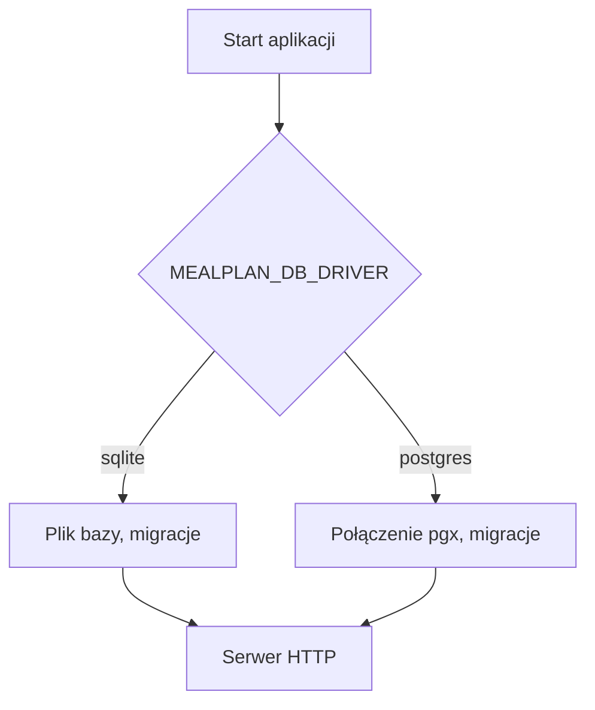

# Tryby wdrożenia i konfiguracja

Jedna baza kodu, dwa tryby wybierane zmienną `MEALPLAN_MODE`. W Etapie 1 działa tylko `selfhost`; wartość `hosted` jest przyjmowana przez konfigurację, ale jego funkcje (samodzielna rejestracja, zaufane proxy) dojdą w Etapie 5.

| Obszar | `selfhost` | `hosted` (Etap 5) |
|---|---|---|
| Baza | SQLite | Postgres |
| Rejestracja | zamknięta, zaproszenia | samodzielna |
| Sieć | Tailscale | reverse proxy i własna domena |

## Zmienne środowiskowe

| Zmienna | Domyślnie | Opis |
|---|---|---|
| `MEALPLAN_MODE` | `selfhost` | `selfhost` lub `hosted` |
| `MEALPLAN_ADDR` | `:8080` | adres nasłuchu |
| `MEALPLAN_DB_DRIVER` | `sqlite` | `sqlite` lub `postgres` |
| `MEALPLAN_DB_DSN` | `file:mealplan.db?_pragma=foreign_keys(1)&_pragma=busy_timeout(5000)&_pragma=journal_mode(WAL)` | połączenie z bazą (w obrazie Docker: plik `/data/mealplan.db`) |
| `MEALPLAN_COOKIE_SECURE` | `true` | ciastka tylko przez HTTPS; ustaw `false` tylko do lokalnych testów po HTTP |
| `MEALPLAN_SESSION_IDLE` | `168h` | wygaśnięcie po bezczynności |
| `MEALPLAN_SESSION_MAX` | `720h` | maksymalny wiek sesji (nie krótszy niż `MEALPLAN_SESSION_IDLE`) |

Czasy podajemy w formacie Go (`168h`, `30m`).
