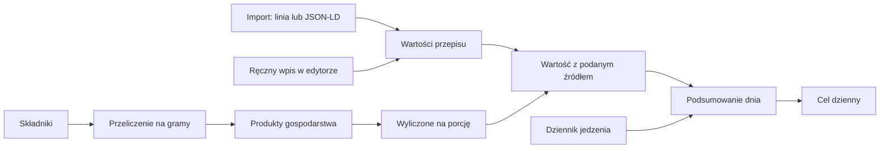

# Wartości odżywcze

Aplikacja pokazuje kalorie i makroskładniki (białko, węglowodany, tłuszcz) przepisu na **jedną porcję** oraz dzienne podsumowanie względem celu. Wszystko jest liczone deterministycznie, bez udziału LLM.

## Skąd biorą się wartości przepisu

Każda z czterech wartości ma własne źródło:

- **przepis** (wpisana ręcznie w edytorze albo zaimportowana): ma pierwszeństwo;
- **wyliczona** ze składników przez bazę produktów gospodarstwa;
- **brak**, gdy nie ma ani wpisanej, ani możliwej do wyliczenia wartości.

Import czyta linię tekstu (`Wartości na porcję: 520 kcal, białko 32 g, węglowodany 60 g, tłuszcz 14 g`) lub pole `nutrition` z JSON-LD; zob. [import.md](import.md). Limity na porcję: kcal 0-5000, każdy makroskładnik 0-500 g; wartość poza zakresem jest pomijana z ostrzeżeniem.

## Przeliczanie składników na gramy

| Jednostka | Przelicznik |
|---|---|
| `g`, `kg` | wprost |
| `ml`, `l` | z gęstością produktu (domyślnie 1 g/ml) |
| `łyżka`, `łyżeczka`, `szklanka` | 15 ml, 5 ml, 250 ml, z gęstością |
| `szt`, `ząbek`, `plaster`, `kostka`, `opakowanie`, `puszka`, `kromka`, `główka`, `pęczek` | przez wagę sztuki produktu; bez niej nie da się przeliczyć |
| `szczypta` | 0,5 g |
| `garść` | 30 g |

Składnik bez ilości liczy się jako 0 bez oznaczania wyniku tylko wtedy, gdy jest pomijalny: dopasował się do produktu o 0 kcal na 100 g (sól, woda) albo jego nazwa lub notatka zawiera „do smaku", „do dekoracji", „do posypania" lub „opcjonalnie". Inny składnik bez ilości (np. „olej" z notatką „do smażenia"), składnik bez dopasowanego produktu albo z ilością, której nie da się przeliczyć, powoduje oznaczenie **przybliżone**: wynik jest wtedy dolną granicą, bo część składników jest nieznana.

## Dopasowanie produktu

Dla każdego składnika aplikacja najpierw bierze produkt zapamiętany przy tym składniku, a potem szuka produktu po znormalizowanej nazwie lub aliasie. Edytor przepisu pokazuje „dopasowano: …" i pozwala wybrać inny produkt; wybór jest zapamiętywany razem z przepisem.

## Produkty i dane startowe

Produkty należą do gospodarstwa (wartości na 100 g, opcjonalnie gęstość i waga sztuki, aliasy) i można je dodawać, zmieniać i usuwać. Przy pierwszym użyciu do gospodarstwa kopiuje się ok. 198 produktów startowych wygenerowanych z **USDA FoodData Central, SR Legacy (kwiecień 2018)**, licencja **CC0 1.0**. Generator i mapowanie nazw (`mapping.csv`) są w `internal/nutrition/seed/gen`.

Znane ograniczenie: w danych startowych nie ma suszonych przypraw (ich błonnik psuje kontrolę zgodności energii). Przepisy z suszonymi przyprawami są „przybliżone", dopóki nie dodasz tych produktów.

## Aliasy, asystent i scalanie produktów

Aliasy produktu (najwyżej 100) pochodzą z ręcznych zmian, z danych startowych i z zatwierdzonych propozycji asystenta (zob. [import.md](import.md)). Czerwona cebula jest osobnym produktem („cebula czerwona"), a nie aliasem zwykłej cebuli, bo ma inne wartości odżywcze.

„Sprawdź produkty" (lista produktów) prosi model o grupy możliwych duplikatów; porównuje nazwy, aliasy i wartości na 100 g. Nic nie jest scalane bez Twojego wyboru, który produkt ma zostać. „Scal z…" w menu produktu robi to samo ręcznie.

Scalenie przenosi do zachowanego produktu: składniki przepisów, spiżarnię (ta sama jednostka jest sumowana, zostaje najwcześniejsza data ważności, a „stały zapas" wygrywa), ruchy spiżarni, dziennik jedzenia i pozycje listy zakupów. Nazwy i aliasy pochłoniętych produktów stają się aliasami zachowanego; aliasy pominięte (należące do innego produktu albo ponad limit 100) są zgłaszane po scaleniu. Pochłonięty produkt jest usuwany.

## Konto: śledzenie, cel i dziennik

Na ekranie **Konto** włączasz śledzenie i ustawiasz dzienny cel; każda wartość celu jest opcjonalna. Dziennik jedzenia zawiera produkt i ilość w `g` lub `szt` (`szt` tylko dla produktu z wagą sztuki) i jest osobisty dla konta.

## Podsumowanie dnia

Dzień to **jedna porcja** każdego zaplanowanego posiłku z przepisu (niezależnie od liczby porcji we wpisie i od „Zrobione") plus dziennik. Dla każdej wartości jest osobna flaga niekompletności, a podsumowanie niesie też `missingMeals` (posiłki bez danych), `missingLog` (wpisy dziennika bez danych) i `approximate`.

- Suma, której nie da się podać, wyświetla się jako „—".
- Pusty dzień to 0, a pozostało całe cel.
- Teksty: „brakuje co najmniej …" (dane niekompletne), „brak danych o …" (wartość nieznana) i „cel osiągnięty".
- W linii tygodnia „≥" oznacza, że suma jest niekompletna.

## API

Trasy `/products`, `/me/nutrition`, `/me/nutrition/days`, `/me/food-log` oraz pola przepisu opisuje [api.md](api.md) i `api/openapi.yaml`.
