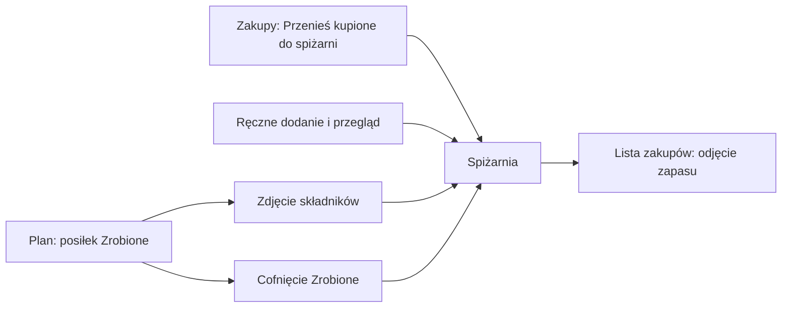

# Spiżarnia

Spiżarnia to zapas produktów gospodarstwa. Lista zakupów odejmuje od potrzeb to, co już masz, a oznaczenie posiłku jako „Zrobione" zdejmuje użyte składniki ze stanu. Wszystko jest liczone deterministycznie, bez udziału LLM.

## Pozycje

Pozycja spiżarni wskazuje **produkt gospodarstwa** (te same produkty, co w [wartościach odżywczych](nutrition.md)). Wpisujesz nazwę albo wybierasz produkt: nazwa pasująca do produktu lub jego aliasu używa go (np. „Ryż" trafia do „ryż biały"), a nieznana nazwa tworzy w locie nowy produkt bez wartości odżywczych.

- Pozycja ma ilość, jednostkę, opcjonalną datę ważności i znacznik **stały zapas**. Dla pary produkt + jednostka jest jedna pozycja: dodanie do istniejącej zwiększa jej ilość. Zmiana jednostki na taką, którą ten produkt już ma w innej pozycji, daje `409 conflict`.
- **Jednostki bazowe**: ilości są zapisywane w jednostkach bazowych: `kg` jako `g`, `l` jako `ml`; pozostałe jednostki kanoniczne (`szt`, `łyżka`, `szklanka` itd.) bez zmian. Wyświetlane są po ludzku (1500 g jako „1,5 kg"). Dozwolona jest dowolna jednostka do 30 znaków, ale jednostka spoza znanych nigdy się z niczym nie dopasuje.
- **Ilość 0** jest dozwolona, pozycja zostaje i jest pokazana z pytaniem „Skończyło się?" (usuń albo zostaw). Ilość: od 0 do 1 000 000.
- **Stały zapas** (sól, olej, mąka na zawsze pod ręką) nie ma ilości, nigdy nie trafia na listę zakupów i nic z niego nie jest odejmowane.
- **Data ważności** (`RRRR-MM-DD`): pozycje przeterminowane (data przed dzisiaj) są podświetlone.
- Przyciski **+** i **-** zmieniają ilość o 50 dla `g` i `ml`, o 1 dla pozostałych jednostek. Zapis jest opóźniony (ok. 0,4 s) i szeregowany: szybkie kliknięcia łączą się w jeden zapis, a naraz leci co najwyżej jedno żądanie; po błędzie ekran wraca do stanu z serwera.

## Przegląd miesięczny

Przycisk „Przegląd" przeprowadza po pozycjach jedna po drugiej (kolejność jest ustalana przy otwarciu):

- „Bez zmian" zostawia pozycję, „Zapisz ilość" zapisuje poprawioną;
- „Nie mamy" usuwa pozycję;
- „Dodaj brakujący" pozwala dopisać produkt, którego nie było;
- „Zakończ przegląd" zapisuje datę przeglądu (`POST /pantry/review`).

Na ekranie „Dziś" pojawia się przypomnienie „Czas na przegląd spiżarni", gdy spiżarnia ma pozycje, a od ostatniego przeglądu minęło **więcej niż 30 dni** (także gdy przeglądu jeszcze nie było). Pusta spiżarnia nie przypomina.

## Lista zakupów a spiżarnia

Generowanie listy (`POST /shopping/generate`):

- pomija posiłki oznaczone „Zrobione" i wpisy tekstem wolnym;
- odejmuje zapas **per produkt**: najpierw w tej samej jednostce bazowej (potrzeba w `g` pomniejsza się o gramy tego samego produktu), potem w innej jednostce zapasu, jeśli da się ją przeliczyć (patrz „Przeliczanie jednostek”). Składnik bez jednostki liczy się jako `szt`;
- wiersz w pełni pokryty zapasem zostaje z ilością 0 jako „masz w domu: X"; pokryty częściowo pokazuje „kup X (masz Y)" (`haveQuantity` w API);
- składniki produktów oznaczonych jako stały zapas są pomijane;
- zapas **nie jest rezerwowany między tygodniami**: dwa tygodnie potrzebujące tej samej mąki odejmują od niej oba pełną ilość. Dlatego odpowiedź listy zawiera `previousWeekUndone` (posiłki z przepisem z poprzedniego tygodnia bez „Zrobione"), a widok zakupów ostrzega, że część zapasów może być już na nie potrzebna.

Przycisk „Przenieś kupione do spiżarni" (`POST /shopping/move-to-pantry`) dodaje odhaczone pozycje tygodnia do spiżarni i oznacza je jako przeniesione (znaczek „w spiżarni", pole `moved`). Pozycja jest zajmowana najpierw (atomowo), więc ponowne lub równoległe kliknięcie nie doda jej drugi raz (`moved: 0`). Pozycje bez ilości są pomijane, pozycje pokryte zapasem (ilość 0) też, a pozycja bez jednostki trafia jako `szt`. Pozycja wygenerowana z przepisu zapamiętuje dopasowany produkt (także ręcznie powiązany) i trafia do jego zapasu; pozycje ręczne są dopasowywane po nazwie. Gdy dodanie którejś się nie uda, jest zwalniana i następna próba ją ponowi. Zmiana ilości odhaczonej pozycji przy regeneracji zeruje `checked` i `moved`.

## „Zrobione" zdejmuje składniki

Oznaczenie posiłku z przepisu jako „Zrobione" (zapis wpisu planu z `done: true`) zdejmuje składniki ze spiżarni:

- ilości są **przeskalowane do porcji wpisu**; składnik bez jednostki liczy się jako `szt`;
- liczą się tylko składniki z ilością, dopasowane do produktu, który masz w spiżarni w tej samej jednostce bazowej albo w jednostce, na którą da się je przeliczyć (łyżka oleju odejmuje 15 ml), i nie będące stałym zapasem;
- stan **nie spada poniżej 0**;
- zapisywane jest, ile faktycznie zdjęto; **cofnięcie** („Zrobione" wyłączone) zwraca dokładnie to;
- operacja jest oparta na stanie wpisu: ponowny zapis wpisu, który już jest zrobiony, nie odejmuje drugi raz;
- **usunięcie** zrobionego wpisu nie zwraca zapasu;
- posiłki tekstem wolnym nie zdejmują niczego.

Jeśli posiłek zapisał się, ale aktualizacja spiżarni nie, API zwraca `500 pantry_failed`; ponowny zapis wpisu naprawia stan.

Znane zachowanie: posiłek zrobiony, zanim w spiżarni pojawiły się zapasy, może zdjąć je później przy kolejnym zapisie wpisu (nie ma jeszcze zapisanych zdjęć).

### Przeliczanie jednostek

Gdy składnik jest w innej jednostce niż zapas tego produktu, aplikacja przelicza go tylko wtedy, gdy wynik jest pewny:

- łyżka = 15 ml, łyżeczka = 5 ml, szklanka = 250 ml: łyżki oliwy pomniejszają butelkę w `ml`;
- objętość na gramy (i odwrotnie) tylko dla produktu z wpisaną gęstością (g/ml): 2 szklanki mąki przy 0,6 g/ml to 300 g z torby w `g`;
- sztuki na gramy (i odwrotnie) tylko dla produktu z wpisaną wagą sztuki;
- bez gęstości lub wagi sztuki nic nie jest zakładane: wiersz zostaje nieodjęty.

Na liście zakupów wiersz zachowuje jednostkę z przepisu („kup 2 łyżki (masz 2)”), a przy „Zrobione” zapas schodzi w swojej jednostce.

## Czego nie robi

- Nie zgaduje gęstości ani wagi sztuki: bez nich objętość nie pomniejsza zapasu w gramach, a sztuki zapasu w gramach. Nie przelicza jednostek takich jak ząbek, puszka czy opakowanie.
- Dwie nazwy tego samego produktu w przepisach (np. „cebula" i „cebule") bez wspólnego dopasowania zostają dwoma wierszami listy zakupów.
- Dowolne jednostki są przyjmowane, ale nigdy nie są dopasowywane do składników.
- Nie rezerwuje zapasu między tygodniami (patrz wyżej); ostrzega tylko liczbą niezrobionych posiłków z poprzedniego tygodnia.

API: [api.md](api.md).
