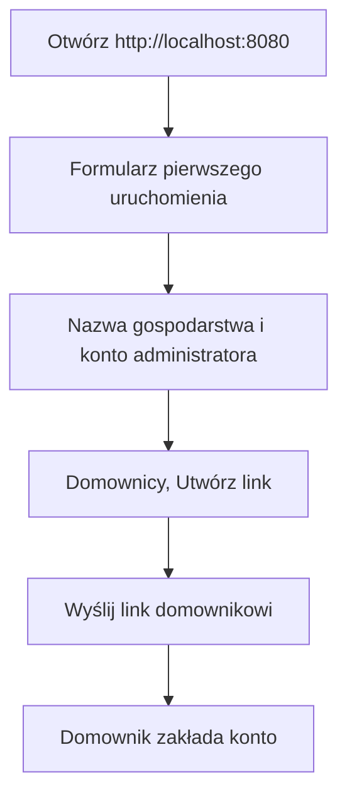

# Szybki start (selfhost)

Ten przewodnik prowadzi od zera do działającej aplikacji dla Twojego domu. Mealplan to jeden program z wbudowanym interfejsem i bazą SQLite, więc nie potrzebujesz osobnego serwera bazy danych.

Co dostajesz: konta domowników i zaproszenia, przepisy, tygodniowy plan (kto gotuje i na ile porcji) oraz listę zakupów. Aplikacja działa w przeglądarce na telefonie i komputerze.

## Wymagania

- Ścieżka A (zalecana): Docker. Nie musisz instalować Go ani Node.
- Ścieżka B: Go 1.26, Node 22 i `make`.

Gotowy obraz w rejestrze jeszcze nie istnieje, dlatego obraz budujesz lokalnie z tego repozytorium. Pierwsze budowanie trwa kilka minut.

```bash
git clone https://github.com/MarcinCho/mealplan.git
cd mealplan
```

## Ścieżka A: Docker

```bash
docker build -t mealplan .
docker run -d --name mealplan --restart unless-stopped \
  -p 127.0.0.1:8080:8080 -v mealplan-data:/data \
  -e MEALPLAN_COOKIE_SECURE=false mealplan
```

- `-p 127.0.0.1:8080:8080` wystawia aplikację tylko na tym komputerze. Nie zmieniaj tego na `8080:8080`, dopóki nie skończysz pierwszej konfiguracji (zobacz niżej).
- `-v mealplan-data:/data` to nazwany wolumen z bazą. Bez niego dane znikną razem z kontenerem.
- `MEALPLAN_COOKIE_SECURE=false` jest potrzebne tylko do testu po zwykłym `http://localhost`. Przy HTTPS usuń je (patrz sekcja HTTPS).

Sprawdź, że działa: `curl -s localhost:8080/api/v1/auth/status` zwraca JSON z `setupRequired: true`, dopóki nie utworzysz konta.

## Ścieżka B: z kodu źródłowego

```bash
make build
MEALPLAN_COOKIE_SECURE=false ./bin/mealplan
```

`make build` najpierw buduje interfejs (`npm ci` i `npm run build` w `web/`), a potem binarkę `bin/mealplan`. Samo `go build` bez wcześniejszego zbudowania interfejsu daje pustą stronę. Możesz też użyć `make run`, które robi to samo.

Domyślnie baza to plik `mealplan.db` w katalogu, z którego uruchamiasz program (wraz z plikami `-wal` i `-shm`). Adres nasłuchu to `:8080`. Pełna lista zmiennych jest w [Tryby i konfiguracja](modes.md), np. `MEALPLAN_ADDR`, `MEALPLAN_DB_DSN`.

## Pierwsze uruchomienie



1. Otwórz `http://localhost:8080`. Zobaczysz formularz pierwszego uruchomienia.
2. Podaj nazwę gospodarstwa, login (3 do 64 znaków: małe litery, cyfry, `.`, `_`, `-`), nazwę wyświetlaną i hasło administratora. Hasło ma od 12 do 128 znaków.
3. Aby dodać rodzinę, wejdź w zakładkę Domownicy i w sekcji Zaproszenia wybierz Utwórz link. Link jest ważny 72 godziny, jest jednorazowy i pokazuje się tylko raz, więc skopiuj go od razu.

Uwaga: dopóki nie ukończysz kroku 2, formularz może wypełnić każdy, kto ma dostęp do adresu. Nie wystawiaj portu publicznie przed jego zakończeniem.

## HTTPS i dostęp z telefonu (Tailscale)

Telefon potrzebuje HTTPS, a zaproszenia muszą być tworzone przez adres, który zadziała u odbiorcy (link budowany jest z adresu strony, więc link z `localhost` nie zadziała). Najprościej użyć Tailscale:

```bash
tailscale serve --bg 8080
```

Potem kontener musi działać z `MEALPLAN_COOKIE_SECURE=true` (domyślnie). Jeśli uruchomiłeś go z `-e MEALPLAN_COOKIE_SECURE=false`, utwórz go ponownie bez tej zmiennej. Dane są bezpieczne w wolumenie:

```bash
docker rm -f mealplan
docker run -d --name mealplan --restart unless-stopped \
  -p 127.0.0.1:8080:8080 -v mealplan-data:/data mealplan
```

Szczegóły (certyfikaty, udostępnianie maszyny domownikom) opisuje [Wdrożenie selfhost z Tailscale](deployment-selfhost.md).

## Docker Compose

W katalogu głównym repozytorium leży plik `docker-compose.yml` z tą samą konfiguracją (budowanie lokalne, wolumen `mealplan-data`, port tylko na `127.0.0.1`, `restart: unless-stopped`):

```bash
docker compose up -d --build
docker compose logs -f
docker compose down
```

`docker compose down` nie usuwa wolumenu z danymi (usunąłby go dopiero `down -v`). Do testu po HTTP w `docker-compose.yml` usuń `# ` z początku linii `# MEALPLAN_COOKIE_SECURE: "false"` (zachowaj wcięcie, linia leży pod `environment:`).

Polityka `restart: unless-stopped` (w `docker run`: `--restart unless-stopped`) uruchamia aplikację ponownie po restarcie komputera i po awarii, dopóki sam jej nie zatrzymasz.

## Dane, kopie zapasowe, aktualizacje, logi

Wszystkie dane to baza SQLite: `/data/mealplan.db` (plus `-wal` i `-shm`, jeśli istnieją) w wolumenie `mealplan-data`.

Kopia zapasowa (zatrzymaj kontener, skopiuj pliki, uruchom ponownie):

```bash
docker stop mealplan
docker run --rm -v mealplan-data:/data -v "$PWD":/backup busybox sh -c 'cp /data/mealplan.db* /backup/'
docker start mealplan
```

Kopiowanie działającej bazy nie jest bezpieczne, bo plik `-wal` może zawierać zmiany jeszcze nieprzeniesione do głównego pliku. Aby przywrócić dane, zatrzymaj kontener i skopiuj pliki z powrotem do `/data` (właścicielem ma być uid 65532).

Aktualizacja: pobierz nowe zmiany, zbuduj obraz i utwórz kontener ponownie. Migracje bazy uruchamiają się automatycznie przy starcie. Wolumen zostaje.

```bash
git pull
docker build -t mealplan .
docker rm -f mealplan
docker run -d --name mealplan --restart unless-stopped \
  -p 127.0.0.1:8080:8080 -v mealplan-data:/data mealplan
```

Przed aktualizacją zrób kopię zapasową. Z Compose: `git pull && docker compose up -d --build`.

Logi: `docker logs -f mealplan` (albo `docker compose logs -f`). Program loguje na stderr, a przy starcie zapisuje linię `listening` z adresem i trybem.

## Rozwiązywanie problemów

| Objaw | Przyczyna i rozwiązanie |
|---|---|
| Pusta strona po zwykłym `go build` | Interfejs nie został zbudowany. Użyj `make build` albo Dockera. |
| `unable to open database file` przy montowaniu katalogu z hosta | Obraz działa jako uid 65532. Wykonaj `sudo chown 65532:65532 ./data` albo użyj wolumenu nazwanego. |
| Logowanie się udaje, ale po chwili wracasz do ekranu logowania | Ciastko `Secure` nie jest wysyłane przez zwykłe HTTP. Do testu lokalnego ustaw `MEALPLAN_COOKIE_SECURE=false`, a na stałe użyj HTTPS. |
| Po włączeniu HTTPS logowanie nie działa | Kontener wciąż ma `MEALPLAN_COOKIE_SECURE=false`. Utwórz go ponownie bez tej zmiennej. |
| `port is already allocated` lub `address already in use` | Port 8080 jest zajęty. Zmień lewą stronę mapowania, np. `-p 127.0.0.1:8090:8080`. |
| Zapomniane hasło administratora | W tej wersji nie ma resetu hasła (ani w interfejsie, ani w API). Zapisz hasło administratora w menedżerze haseł i rób kopie zapasowe. W ostateczności zostaje założenie nowego gospodarstwa na pustym wolumenie, co oznacza utratę danych z obecnego. |
| Zbyt wiele nieudanych logowań | Blokada działa na login i adres IP i wygasa po najwyżej 15 minutach (zobacz [Bezpieczeństwo](security.md)). |

## Co dalej

- Dodaj przepisy w zakładce Przepisy.
- Zaplanuj tydzień w zakładce Plan: wybierz, kto gotuje które danie i na ile porcji.
- Wygeneruj listę zakupów w zakładce Zakupy.
- Zaproś resztę rodziny (Domownicy).

Planowane na później: import przepisów, inwentarz, statystyki i tryb hosted.
