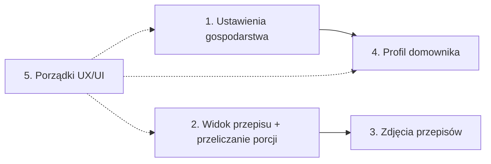

# Roadmapa

Plan kolejnych prac nad Mealplanem. Kolejność to propozycja, a wielkości to szacunek: **S** to jeden wieczór, **M** kilka dni, **L** tydzień lub więcej. Każdy punkt przed budową dostaje krótki projekt do akceptacji, tak jak asystent produktów.

| # | Funkcja | Wielkość | Zależy od |
|---|---|---|---|
| 1 | Ustawienia gospodarstwa (w tym klucz OpenRouter) — **zrobione** | S | — |
| 2 | Widok przepisu do czytania i przeliczanie porcji | M | — |
| 3 | Zdjęcia przepisów | M–L | 2 (zdjęcie pokazuje widok przepisu) |
| 4 | Rozbudowany profil domownika | M | 1 (rozdzielenie ustawień gospodarstwa od osobistych) |
| 5 | Porządki UX/UI | ciągłe | robione przy każdym punkcie, plus osobna lista |

## 1. Ustawienia gospodarstwa (zrobione)

**Dziś:** liczba porcji na posiłek i klucz OpenRouter są na stronie Domownicy, razem z listą osób i zaproszeniami. Nie da się zmienić nazwy gospodarstwa.

**Co budujemy:**
- osobną stronę „Ustawienia gospodarstwa” w menu konta, widoczną dla wszystkich i edytowalną przez administratora;
- przeniesienie tam porcji na posiłek i asystenta produktów (klucz, model, „Sprawdź połączenie”);
- zmianę nazwy gospodarstwa;
- stronę Domownicy tylko dla osób, ról i zaproszeń.

**Poza zakresem:** wiele gospodarstw na jedno konto.

## 2. Widok przepisu do czytania i przeliczanie porcji

**Dziś:** kliknięcie przepisu otwiera od razu pełny formularz edycji ze wszystkimi polami: składnikami w kilku wierszach każdy, produktami i wartościami. Do gotowania to za dużo.

**Co budujemy:**
- **Widok przepisu**, prosty i czytelny na telefonie: tytuł, tagi, (zdjęcie z punktu 3), kalorie na porcję, lista składników w jednej linii każdy („200 g mąka pszenna”), ponumerowane kroki, link do źródła. Przycisk „Edytuj” otwiera dzisiejszy formularz.
- **Przeliczanie porcji** w widoku: pole porcji z przyciskami − i +. Zmiana z 2 na 6 przelicza ilości składników ×3 na ekranie, bez zmiany przepisu. Ilości są zaokrąglane po kuchennemu (np. „1,5 łyżki”, „330 g”), a składniki bez ilości („sól do smaku”) zostają bez zmian.
- Wejście z planu (np. „Przepis” na ekranie Dziś) otwiera widok od razu z liczbą porcji z wpisu planu.
- Opcjonalnie: odhaczanie kroków i składników podczas gotowania oraz ekran, który nie gaśnie.

**Do decyzji:**
- Czy przeliczona liczba porcji ma się dać zapisać jako nowe „porcje bazowe” przepisu?

## 3. Zdjęcia przepisów

**Dziś:** baza ma przygotowane pole na zdjęcie (`recipe.image_path`), ale nie ma przesyłania plików.

**Co budujemy:**
- dodanie zdjęcia w edycji przepisu: z aparatu telefonu albo z pliku;
- zdjęcie na górze widoku przepisu i miniatura na liście przepisów;
- zmniejszanie i kompresja przy zapisie (np. do 1600 px i do kilkuset KB), żeby baza i kopie zapasowe nie puchły;
- pliki w wolumenie `/data` obok bazy, więc kopia zapasowa obejmuje je razem z bazą;
- przy imporcie z linku propozycja zdjęcia ze strony źródłowej (do zatwierdzenia).

**Do decyzji:**
- Jedno zdjęcie na przepis czy galeria (np. zdjęcia kolejnych kroków)?
- Czy zdjęcia z importu pobierać automatycznie, czy tylko na kliknięcie?

**Bezpieczeństwo:** sprawdzanie typu i rozmiaru pliku, usuwanie metadanych (np. lokalizacji GPS ze zdjęć z telefonu), zdjęcia widoczne tylko dla członków gospodarstwa.

## 4. Rozbudowany profil domownika

**Dziś:** strona Konto ma tylko śledzenie kalorii i język. Nie da się zmienić swojego imienia ani hasła.

**Co budujemy:**
- zmianę wyświetlanego imienia i hasła (z podaniem obecnego);
- kolor lub zdjęcie avatara, widoczne przy „Kto gotuje”;
- język zapisany w profilu, a nie tylko w przeglądarce, żeby działał na każdym urządzeniu;
- preferencje: ulubione przepisy, czego nie je (alergie, „bez mięsa”) i ostrzeżenie przy planowaniu przepisu z takim składnikiem;
- cel kalorii i makro, jak dziś, w tym samym miejscu.

**Do decyzji:**
- Które z tych elementów są najważniejsze? Proponuję zacząć od imienia, hasła i avatara.
- Czy administrator ma móc resetować hasło domownika? Dziś zapomniane hasło oznacza utratę konta.

## 5. Porządki UX/UI

Robione przy każdym z punktów powyżej, a do tego osobna lista znanych niedociągnięć:

- **Edytor przepisu na telefonie:** każdy składnik zajmuje kilka wierszy. Proponuję zwarty wiersz z rozwijaniem szczegółów.
- **Menu konta:** Produkty, Domownicy i Konto są schowane pod kółkiem z inicjałem, a ustawienia są rozrzucone. Punkt 1 i 4 to porządkują.
- **Lista produktów:** każdy wiersz ma osobno przycisk „Usuń” i menu ⋮. Usuwanie powinno trafić do menu.
- **„Sprawdź przepisy” i „Sprawdź produkty”:** „Przerwij” nie przerywa odliczania przy limicie zapytań. Komunikat „nic do zmiany” pojawia się też po ręcznym obsłużeniu wszystkich wierszy. Grupy w „Sprawdź produkty” nie mają opisów dla czytników ekranu.
- **Lista do uzupełnienia:** zebranie Twoich uwag z codziennego używania, najlepiej ze zrzutami ekranu.

## Kolejność

1. **Ustawienia gospodarstwa**: małe, a od razu porządkuje to, gdzie co jest.
2. **Widok przepisu z przeliczaniem porcji**: największa zmiana w codziennym gotowaniu.
3. **Zdjęcia przepisów**: korzystają z nowego widoku przepisu.
4. **Profil domownika**: po rozdzieleniu ustawień gospodarstwa od osobistych.

Porządki UX/UI idą równolegle, małymi poprawkami przy każdym wdrożeniu.
