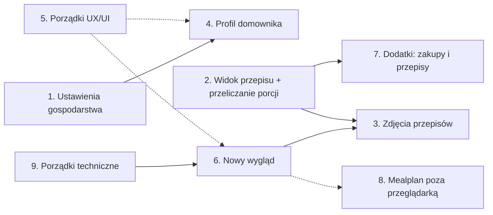

# Roadmapa

Plan kolejnych prac nad Mealplanem. Kolejność to propozycja, a wielkości to szacunek: **S** to jeden wieczór, **M** kilka dni, **L** tydzień lub więcej. Każdy punkt przed budową dostaje krótki projekt do akceptacji, tak jak asystent produktów.

| # | Funkcja | Wielkość | Zależy od |
|---|---|---|---|
| 1 | Ustawienia gospodarstwa (w tym klucz OpenRouter) — **zrobione** | S | — |
| 2 | Widok przepisu do czytania i przeliczanie porcji — **zrobione** | M | — |
| 3 | Zdjęcia przepisów | M–L | 2 i 6 (zdjęcie pokazuje widok przepisu w nowym wyglądzie) |
| 4 | Rozbudowany profil domownika (najpierw reset hasła przez administratora) | M | 1 (rozdzielenie ustawień gospodarstwa od osobistych) |
| 5 | Porządki UX/UI | ciągłe | robione przy każdym punkcie, plus osobna lista |
| 6 | Nowy wygląd („notes” w kolorach Mealplana) | L | 9 (decyzja o Vuetify 4) |
| 7 | Dodatki: składniki przepisu do zakupów, zakupy na żywo, sekcja „Inne” | 3 × S | 2 |
| 8 | Mealplan poza przeglądarką: aplikacja na ekranie telefonu, przypomnienia, plan w kalendarzu | M | najlepiej po 6 |
| 9 | Porządki techniczne: końce linii, zależności, Vuetify 4 | S | — |

## 1. Ustawienia gospodarstwa (zrobione)

**Dziś:** liczba porcji na posiłek i klucz OpenRouter są na stronie Domownicy, razem z listą osób i zaproszeniami. Nie da się zmienić nazwy gospodarstwa.

**Co budujemy:**
- osobną stronę „Ustawienia gospodarstwa” w menu konta, widoczną dla wszystkich i edytowalną przez administratora;
- przeniesienie tam porcji na posiłek i asystenta produktów (klucz, model, „Sprawdź połączenie”);
- zmianę nazwy gospodarstwa;
- stronę Domownicy tylko dla osób, ról i zaproszeń.

**Poza zakresem:** wiele gospodarstw na jedno konto.

## 2. Widok przepisu do czytania i przeliczanie porcji (zrobione)

**Dziś:** kliknięcie przepisu otwiera od razu pełny formularz edycji ze wszystkimi polami: składnikami w kilku wierszach każdy, produktami i wartościami. Do gotowania to za dużo.

**Co budujemy:**
- **Widok przepisu**, prosty i czytelny na telefonie: tytuł, tagi, (zdjęcie z punktu 3), kalorie na porcję, lista składników w jednej linii każdy („200 g mąka pszenna”), ponumerowane kroki, link do źródła. Przycisk „Edytuj” otwiera dzisiejszy formularz.
- **Przeliczanie porcji** w widoku: pole porcji z przyciskami − i +. Zmiana z 2 na 6 przelicza ilości składników ×3 na ekranie, bez zmiany przepisu. Ilości są zaokrąglane po kuchennemu (np. „1,5 łyżki”, „330 g”), a składniki bez ilości („sól do smaku”) zostają bez zmian.
- Wejście z planu (np. „Przepis” na ekranie Dziś) otwiera widok od razu z liczbą porcji z wpisu planu.
- Opcjonalnie: odhaczanie kroków i składników podczas gotowania oraz ekran, który nie gaśnie.

**Do decyzji:**
- Czy przeliczona liczba porcji ma się dać zapisać jako nowe „porcje bazowe” przepisu? Nie: przeliczona liczba porcji się nie zapisuje, a porcje bazowe zmienia się w „Edytuj”.

## 3. Zdjęcia przepisów

**Dziś:** baza ma przygotowane pole na zdjęcie (`recipe.image_path`), ale nie ma przesyłania plików.

**Co budujemy:**
- dodanie zdjęcia w edycji przepisu: z aparatu telefonu albo z pliku;
- zdjęcie na górze widoku przepisu i miniatura na liście przepisów;
- zmniejszanie i kompresja przy zapisie (np. do 1600 px i do kilkuset KB), żeby baza i kopie zapasowe nie puchły;
- pliki w wolumenie `/data` obok bazy, więc kopia zapasowa obejmuje je razem z bazą;
- przy imporcie z linku propozycja zdjęcia ze strony źródłowej (do zatwierdzenia).

**Do decyzji:**
- Jedno zdjęcie na przepis czy galeria (np. zdjęcia kolejnych kroków)?
- Czy zdjęcia z importu pobierać automatycznie, czy tylko na kliknięcie?

**Bezpieczeństwo:** sprawdzanie typu i rozmiaru pliku, usuwanie metadanych (np. lokalizacji GPS ze zdjęć z telefonu), zdjęcia widoczne tylko dla członków gospodarstwa.

## 4. Rozbudowany profil domownika

**Dziś:** strona Konto ma tylko śledzenie kalorii i język. Nie da się zmienić swojego imienia ani hasła, a zapomniane hasło oznacza utratę konta.

**Co budujemy, w tej kolejności:**
1. **reset hasła domownika przez administratora** (jednorazowe hasło albo link ważny krótko, jak zaproszenie), bo dziś zapomniane hasło to utracone konto;
2. zmianę wyświetlanego imienia i hasła (z podaniem obecnego);
3. kolor lub zdjęcie avatara, widoczne przy „Kto gotuje”;
4. język zapisany w profilu, a nie tylko w przeglądarce, żeby działał na każdym urządzeniu;
5. preferencje: ulubione przepisy, czego nie je (alergie, „bez mięsa”) i ostrzeżenie przy planowaniu przepisu z takim składnikiem;
6. cel kalorii i makro, jak dziś, w tym samym miejscu.

**Do decyzji:**
- Jak ma wyglądać reset: administrator nadaje jednorazowe hasło czy wysyła link do ustawienia nowego?

## 5. Porządki UX/UI

Robione przy każdym z punktów powyżej, a do tego osobna lista znanych niedociągnięć:

- **Edytor przepisu na telefonie:** każdy składnik zajmuje kilka wierszy. Proponuję zwarty wiersz z rozwijaniem szczegółów.
- **Menu konta:** Produkty, Domownicy i Konto są schowane pod kółkiem z inicjałem, a ustawienia są rozrzucone. Punkt 1 i 4 to porządkują.
- **Lista produktów:** każdy wiersz ma osobno przycisk „Usuń” i menu ⋮. Usuwanie powinno trafić do menu.
- **„Sprawdź przepisy” i „Sprawdź produkty”:** „Przerwij” nie przerywa odliczania przy limicie zapytań. Komunikat „nic do zmiany” pojawia się też po ręcznym obsłużeniu wszystkich wierszy. Grupy w „Sprawdź produkty” nie mają opisów dla czytników ekranu.
- **Historia przeglądarki w edytorze:** po „Anuluj” przycisk „wstecz” otwiera znowu formularz. Zapis już tego nie robi; „Anuluj” i „Usuń” powinny działać tak samo.
- **Lista do uzupełnienia:** zebranie Twoich uwag z codziennego używania, najlepiej ze zrzutami ekranu.

## 6. Nowy wygląd

**Dziś:** Vuetify w stylu Material 3 (pigułkowe przyciski, karty z ramką, duże zaokrąglenia), czcionka systemowa, pięć palet do wyboru.

**Wybrany kierunek:** „spokojnie jak notes” w kolorach Mealplana. Ciepłe, liniowane strony zamiast kart, czcionki Red Hat (Display do nagłówków, Text do treści), zielonkawa biel jako tło, ciemna zieleń `#233831` zamiast czerni, `#4F6B3F` dla głównej akcji i zaznaczeń, szałwia w ozdobnikach, osobna zieleń dla „zrobione”. Makiety trzech ekranów (Dziś, Przepis, Plan) na telefon i komputer powstały w przeglądzie kierunków z Hallmark.

**Co budujemy:**
- motyw Vuetify: kolory, czcionki, zaokrąglenia i domyślne warianty komponentów, tak żeby każdy ekran od razu dostał nowy wygląd;
- nowy układ trzech głównych ekranów: Dziś (karta „co teraz gotujemy” z dużym „Zrobione”), Przepis (składniki w karcie z licznikiem porcji) i Plan (jedna linia na dzień, na telefonie blok na dzień);
- „Meal prep” w menu na telefonie i komputerze (makiety go pominęły);
- stany ładowania i błędu dla nowych układów, których makiety nie rysują.

**Do decyzji:**
- Czy zostaje wersja ciemna i cztery zapasowe palety, czy nowy wygląd zastępuje wybór palet?
- Czy przed tym punktem przechodzimy na Vuetify 4 (punkt 9)?

## 7. Dodatki: zakupy i przepisy

Pomysły z porównania z aplikacją Domownik, wybrane tak, żeby Mealplan został prosty:

- **Składniki przepisu do zakupów:** przycisk „Do zakupów” w widoku przepisu dopisuje składniki do listy bieżącego tygodnia, od razu przeliczone na wybraną liczbę porcji, bez planowania posiłku.
- **Zakupy na żywo:** lista zakupów odświeża się sama co kilka sekund i po powrocie do karty, więc dwie osoby w sklepie widzą nawzajem odhaczone pozycje.
- **Sekcja „Inne”:** ręczne pozycje niespożywcze (chemia, drogeria) w osobnej sekcji tej samej listy, zamiast wielu list.
- Opcjonalnie: przy „Kto ugotuje?” podpowiedź, kto gotował w tym tygodniu najmniej (licznik już jest na ekranie Dziś).

## 8. Mealplan poza przeglądarką

- **Aplikacja na ekranie telefonu (PWA):** ikona na ekranie głównym i lista zakupów działająca bez zasięgu w sklepie.
- **Przypomnienia:** powiadomienia, np. rano „dziś gotujesz: zupa ogórkowa”, „jogurt traci ważność jutro”, „czas na przegląd spiżarni”. Wymagają PWA i HTTPS (Tailscale już to daje).
- **Plan w kalendarzu:** prywatny link iCal z planem posiłków i tym, kto gotuje, do subskrypcji w Google lub Apple Calendar. Daje wspólny kalendarz bez budowania własnego.

**Do decyzji:** które przypomnienia i o której godzinie; czy każdy domownik wybiera je sam.

## 9. Porządki techniczne

- **Końce linii:** `.gitattributes` z `eol=lf`. Na Windowsie z `core.autocrlf=true` dwa testy Go (`TestRoutesMatchOpenAPI`, `TestSkillExamplesImport`) padają przez CRLF.
- **Zależności:** scalić zielone aktualizacje od Dependabota; vite 8 i vitest 5 podnieść razem, bo osobno nie przechodzą CI.
- **Vuetify 4:** zdecydować przed punktem 6, żeby nie robić nowego wyglądu dwa razy.

## Czego świadomie nie budujemy

Porównanie z aplikacją Domownik (rodzinny organizer) pokazało funkcje, które zrobiłyby z Mealplana ogólny organizer domu: kalendarz wydarzeń, zadania domowe z punktami i nagrodami, czat, plan zajęć z tygodniami A/B, kontakty rodziny i listy pakowania. Zostajemy przy jedzeniu: przepisy, plan, zakupy, spiżarnia, gotowanie i kalorie. Kalendarz rodziny łączymy z Mealplanem linkiem iCal (punkt 8), a nie własnym kalendarzem.

## Kolejność

1. ~~**Ustawienia gospodarstwa**~~ i ~~**Widok przepisu z przeliczaniem porcji**~~: zrobione.
2. **Porządki techniczne** (9): małe, a odblokowują decyzję o Vuetify 4.
3. **Nowy wygląd** (6): zmienia każdy ekran, więc przed kolejnymi funkcjami z interfejsem.
4. **Dodatki: zakupy i przepisy** (7): trzy małe rzeczy, które od razu przydają się w kuchni i w sklepie.
5. **Profil domownika** (4): zaczynając od resetu hasła.
6. **Zdjęcia przepisów** (3): w nowym wyglądzie widoku przepisu.
7. **Mealplan poza przeglądarką** (8): aplikacja na telefonie, przypomnienia, kalendarz.

Porządki UX/UI idą równolegle, małymi poprawkami przy każdym wdrożeniu.
