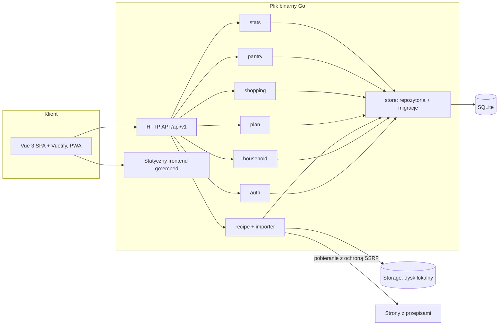
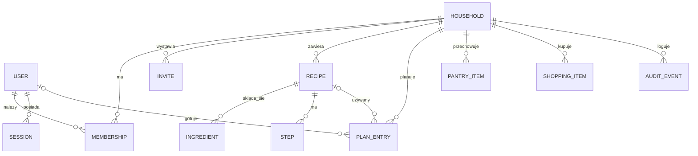
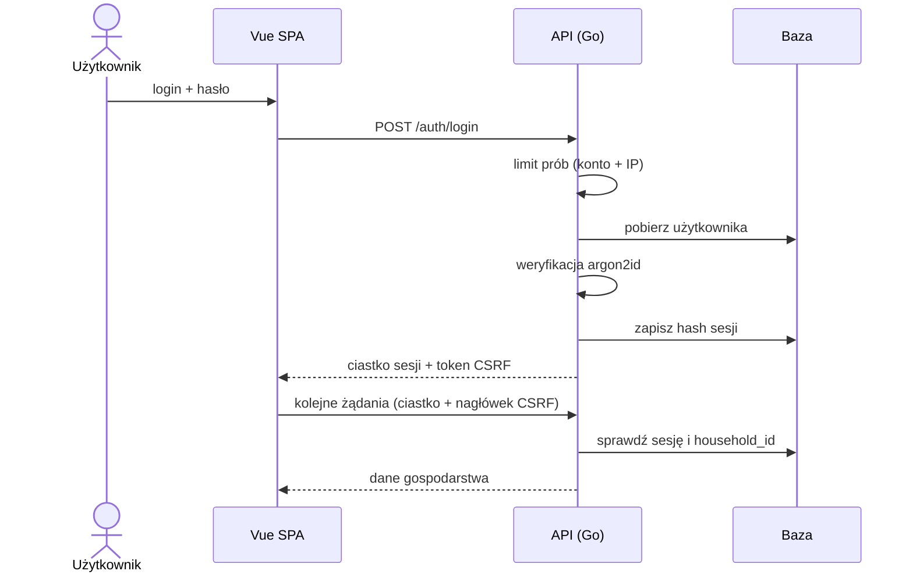
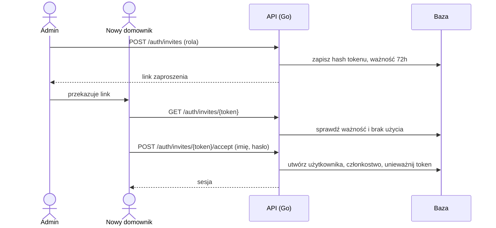
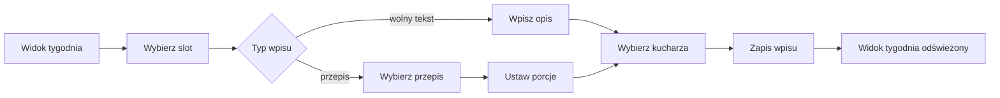
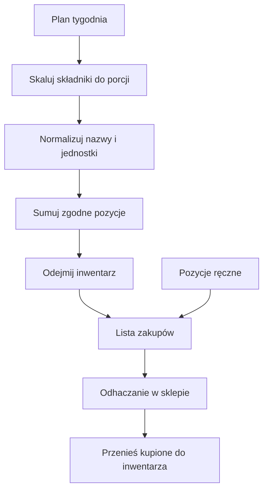
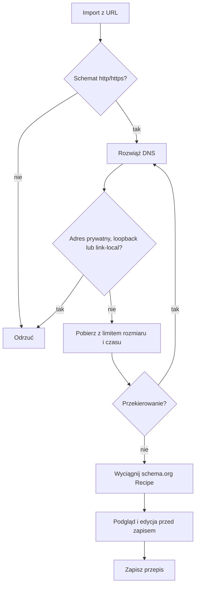
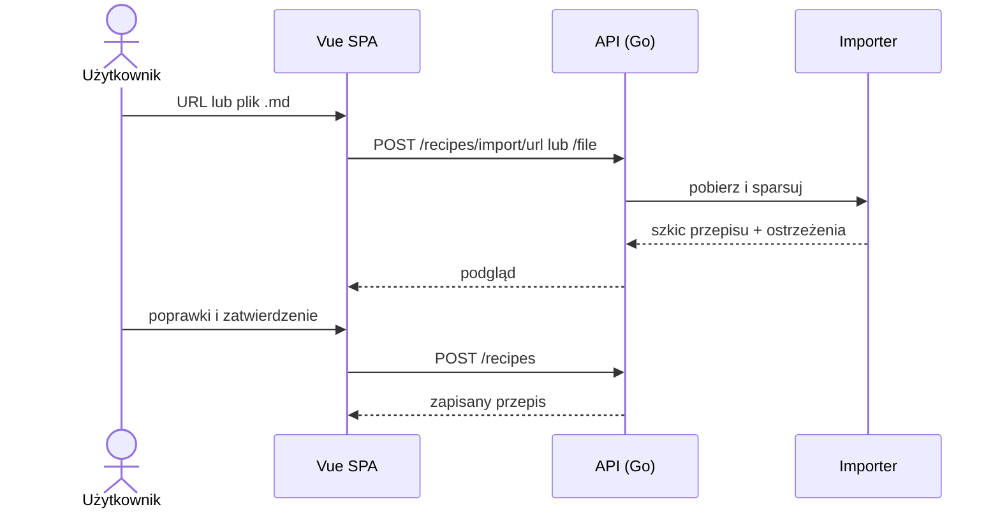

# Mealplan: projekt systemu

Data: 2026-11-01 · Status: do przeglądu · Licencja projektu: MIT

## 1. Cel i zakres

Mealplan to lekka aplikacja webowa dla gospodarstwa domowego. Pozwala rozpisać jadłospis na tydzień, przypisać osobę odpowiedzialną za każde danie, wygenerować listę zakupów, importować przepisy z plików Markdown i z sieci, śledzić inwentarz domowy oraz przeglądać statystyki użycia przepisów.

**Kryteria sukcesu**
- Domownicy planują tydzień w kilka minut, także z telefonu.
- Lista zakupów powstaje jednym kliknięciem, uwzględnia porcje i to, co jest w domu.
- Aplikacja działa jako jeden plik binarny (lub kontener) bez zewnętrznych usług.
- Dane są prywatne: konta z hasłem, dostęp przez Tailscale.
- Architektura nie blokuje przyszłej wersji hostowanej (wielu najemców).

**Poza zakresem (YAGNI):** skanowanie kodów kreskowych, integracje ze sklepami, powiadomienia push, aplikacje natywne, wersja hostowana (tylko przygotowanie architektury).

## 2. Założenia i decyzje

| Decyzja | Wybór |
|---|---|
| Backend | Go, REST/JSON `/api/v1`, OpenAPI jako źródło prawdy |
| Frontend | Vue 3 + Vite + Pinia + Vuetify 3 (Material Design), PWA |
| Dystrybucja | Jeden plik binarny z frontendem w `go:embed`, obraz Docker |
| Baza | SQLite (`modernc.org/sqlite`, bez CGO), repozytoria za interfejsami (możliwość Postgres) |
| Konta | Hasła, role `admin`/`member`, zaproszenia jednorazowe, brak otwartej rejestracji |
| Sieć | Dostęp przez Tailscale (`tailscale serve` zapewnia HTTPS) |
| Multi-tenancy | Gospodarstwo (`household`) jest tenantem od początku |
| Konfiguracja | Wyłącznie zmienne środowiskowe, aplikacja bezstanowa |
| Pliki | Interfejs `Storage` (dysk lokalny, później S3) |
| Siatka planu | Dzień × slot (śniadanie, obiad, kolacja, przekąska), wpis = przepis lub wolny tekst |
| Porcje | Przepis ma porcje bazowe, wpis w planie własne, składniki skalowane proporcjonalnie |

## 3. Architektura



### Struktura repozytorium

```
cmd/mealplan/        punkt wejścia
internal/auth/       hasła, sesje, zaproszenia, CSRF, limity prób
internal/household/  gospodarstwa, członkowie, role
internal/recipe/     przepisy, składniki
internal/importer/   import z .md i URL, parser ilości
internal/plan/       siatka tygodnia, kucharz, porcje
internal/shopping/   generowanie listy zakupów
internal/pantry/     inwentarz
internal/stats/      statystyki
internal/store/      repozytoria, migracje
api/openapi.yaml     kontrakt API
web/                 frontend Vue
docs/                dokumentacja
```

Każdy pakiet ma jedno zadanie i komunikuje się przez interfejsy. Pakiety domenowe nie znają HTTP, a warstwa HTTP nie zna SQL.

## 4. Model danych



- `household(id, name)`, `user(id, login, password_hash, display_name)`, `membership(user_id, household_id, role)`.
- `invite(id, household_id, token_hash, role, expires_at, used_at)`, `session(id, user_id, token_hash, expires_at, last_seen)`.
- `recipe(id, household_id, title, base_servings, source_url, tags, image_path)`; `ingredient(recipe_id, name, normalized_name, quantity, unit)`; `step(recipe_id, position, text)`.
- `plan_entry(id, household_id, date, slot, recipe_id?, free_text?, servings, cook_user_id?)`.
- `pantry_item(id, household_id, name, normalized_name, quantity, unit, expires_on?, low_threshold?)`.
- `shopping_item(id, household_id, name, quantity, unit, checked, manual, week)`.
- `audit_event(id, household_id, user_id, type, at, details)`.

**Izolacja:** każda tabela domenowa ma `household_id`. Repozytoria przyjmują go jako obowiązkowy parametr i dodają do każdego zapytania w jednym miejscu. Testy potwierdzają, że gospodarstwo A nie odczyta ani nie zmieni danych B.

**Jednostki:** ilość to liczba plus jednostka. Obsługiwane konwersje: g↔kg, ml↔l. Konwersje międzygrupowe (np. łyżka↔gram) świadomie pomijamy.

## 5. API

REST/JSON pod `/api/v1`, kontrakt w `api/openapi.yaml`, klient TypeScript generowany z kontraktu. Błędy w jednym formacie: `{code, message, details}`.

| Zasób | Zakres |
|---|---|
| `/auth` | setup (pierwszy admin), login, logout, zaproszenia (utwórz, sprawdź, przyjmij) |
| `/household` | członkowie, zmiana roli, usunięcie członka |
| `/recipes` | CRUD, `/recipes/import/url`, `/recipes/import/file` |
| `/plan/{week}` | wpisy planu, kucharz, porcje, kopiowanie tygodnia |
| `/shopping` | generowanie, pozycje ręczne, odhaczanie, przeniesienie do inwentarza |
| `/pantry` | CRUD pozycji inwentarza |
| `/stats` | rankingi i rozkłady dla wybranego okresu |

## 6. Bezpieczeństwo

- **Hasła:** argon2id, minimum 12 znaków.
- **Sesje:** losowy token 256 bit, w bazie tylko jego hash; ciastko `HttpOnly`, `Secure`, `SameSite=Lax`; wygasanie po bezczynności i limit bezwzględny.
- **CSRF:** token podwójnie przesyłany (ciastko + nagłówek) dla metod modyfikujących.
- **Logowanie:** limit prób na konto i IP z narastającym opóźnieniem; komunikaty nie ujawniają istnienia konta.
- **Zaproszenia:** jednorazowy token (hash w bazie), ważność 72 godziny, z przypisaną rolą.
- **SSRF przy imporcie z URL:** tylko http/https; blokada adresów prywatnych, loopback i link-local, sprawdzana po rozwiązaniu DNS i przy każdym przekierowaniu; limity rozmiaru i czasu. W tailnecie ma to szczególne znaczenie, bo serwer widzi inne maszyny.
- **Import `.md`:** limit rozmiaru; surowy HTML nigdy nie jest renderowany.
- **Nagłówki:** CSP bez `unsafe-inline`, `X-Content-Type-Options`, `Referrer-Policy`. Zapytania SQL w pełni parametryzowane.
- **Audyt:** logowania, zmiany ról, zaproszenia zapisywane w `audit_event`.
- **Izolacja gospodarstw:** patrz sekcja 4.





## 7. Przepływy domenowe

### 7.1 Planowanie tygodnia

Edycja zapisuje się na bieżąco, bez przycisku "zapisz". Wpisy są niezależne, więc przy równoczesnej edycji wygrywa ostatni zapis. Plan można skopiować z poprzedniego tygodnia.



### 7.2 Lista zakupów

Generowana na żądanie z wybranego zakresu dni (domyślnie cały tydzień).

1. Zbierz składniki z przepisów w planie, skalując: `ilość × porcje_w_planie ÷ porcje_bazowe`.
2. Zsumuj po znormalizowanej nazwie i zgodnych jednostkach.
3. Odejmij to, co jest w inwentarzu.
4. Pozycje o niezgodnych jednostkach (np. "2 sztuki" i "200 g") zostają osobnymi wierszami.

Lista jest checklistą. Pozycje ręczne można dodawać. Regeneracja zachowuje pozycje ręczne i stan odhaczeń tam, gdzie pozycja się nie zmieniła. Odhaczone pozycje można jednym kliknięciem przenieść do inwentarza.



### 7.3 Import przepisów

Wspólny pipeline: parsowanie → podgląd → edycja → zapis. Użytkownik zawsze widzi wynik i poprawia go przed zapisem.

- **URL:** pobranie z ochroną SSRF, ekstrakcja `schema.org/Recipe` z JSON-LD. Gdy parsowanie się nie powiedzie, użytkownik dostaje komunikat i może wkleić przepis ręcznie.
- **Plik `.md`:** frontmatter (tytuł, porcje, tagi, źródło), sekcja `## Składniki` z listą (`- 200 g mąki`), sekcja `## Kroki` z listą numerowaną. Parser toleruje drobne odchylenia. Obsługa wielu plików naraz. Format opisany w `docs/import.md`.
- **Duplikaty:** wykrywane po adresie źródłowym i tytule, z pytaniem "zaktualizować czy dodać nowy".
- **Parser ilości** ("1/2", "1 ½", "szczypta") to osobny pakiet z testami tablicowymi.





### 7.4 Inwentarz

Lista produktów z ilością, jednostką i opcjonalną datą ważności. Wyszukiwanie, edycja inline, szybkie +/−. Pozycje poniżej opcjonalnego progu są podpowiedzią do listy zakupów.

### 7.5 Statystyki

Liczone zapytaniami z `plan_entry`, bez osobnych tabel: najczęściej używane przepisy, przepisy nieużywane od dawna, liczba posiłków na kucharza, rozkład po tagach. Okres: tydzień, miesiąc, rok. Prezentacja: prosty wykres słupkowy i ranking.

## 8. Interfejs

Material Design przez Vuetify 3, minimalistyczny, podejście mobile-first. Na telefonie nawigacja dolna, na komputerze boczny rail. Widok tygodnia na telefonie jest listą dni, na komputerze siatką. Jasny i ciemny motyw. PWA (instalacja na ekranie głównym). Importowanie tylko używanych komponentów Vuetify, by ograniczyć rozmiar bundle'a.

## 9. Ścieżka do wersji hostowanej

Architektura przygotowuje grunt, ale nie implementuje wersji hostowanej:
- tenancy przez `household_id` i członkostwo (relacja 1:1 teraz, schemat dopuszcza więcej),
- tryb rejestracji konfigurowalny (zamknięta teraz, samodzielna później),
- repozytoria za interfejsami (zamiana SQLite na Postgres),
- `Storage` za interfejsem (S3),
- sesje w bazie, konfiguracja w środowisku, brak stanu w pamięci procesu.

Poza obecnym zakresem pozostają: rozliczenia, e-mail (reset hasła), limity zasobów na najemcę, panel operatora.

## 10. Testy

- **Jednostkowe (Go):** skalowanie i sumowanie, normalizacja jednostek, parser ilości i `.md`, walidacja SSRF (tabela adresów).
- **Integracyjne (Go):** API na tymczasowej SQLite; izolacja gospodarstw, CSRF, limity prób, wygasanie sesji i zaproszeń.
- **Frontend:** Vitest (logika, komponenty); Playwright dla ścieżek: logowanie, zaproszenie, planowanie tygodnia, lista zakupów, import, w widoku mobilnym i desktopowym.
- **CI (GitHub Actions):** lint, testy, build binarki i obrazu Docker, `govulncheck`, audyt npm.
- **Dokumentacja:** sprawdzenie zgodności `openapi.yaml` z implementacją, renderowania diagramów mermaid.

## 11. Dokumentacja

- `README.md`: opis, szybki start (binarka, Docker), konfiguracja.
- `docs/architecture.md`: komponenty, diagram ER, przepływy.
- `docs/security.md`: model zagrożeń i zabezpieczenia.
- `docs/deployment.md`: Tailscale (`tailscale serve`), Docker, backup SQLite, ścieżka do wersji hostowanej.
- `docs/api.md` i `api/openapi.yaml`.
- `docs/import.md`: format Markdown z przykładami.
- `CONTRIBUTING.md`, `LICENSE` (MIT), `CHANGELOG.md`.

Diagramy mermaid są utrzymywane w repozytorium obok kodu.

## 12. Etapy realizacji

1. **Fundament:** szkielet repozytorium, baza i migracje, auth, gospodarstwa i zaproszenia, powłoka UI z motywem Material.
2. **Rdzeń:** przepisy (dodawanie ręczne), plan tygodnia z kucharzem i porcjami, lista zakupów.
3. **Import i dane:** import z `.md` i URL, inwentarz zintegrowany z listą zakupów.
4. **Statystyki i szlif:** statystyki, PWA, dokumentacja końcowa, wydanie 0.1.

Każdy etap kończy się działającą, wydawalną wersją i ma własny plan wdrożenia.
